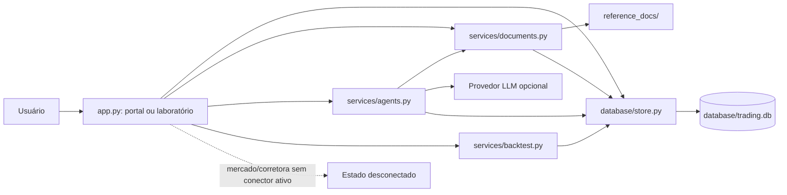

# Referência técnica — Trading Agent Lab

> Documentação do comportamento implementado e do estado observado em 13/11/2026. O código é a autoridade para implementação; `AGENTS.md` contém requisitos e decisões vigentes. Esta referência descreve o sistema existente e separa claramente o que ainda depende de dados, configuração ou decisão humana.

## 1. Visão geral

Trading Agent Lab é um aplicativo local em Python e Streamlit para organizar seis agentes de pesquisa intraday, registrar conhecimento e eventos, indexar PDFs localmente e avaliar estratégias sobre histórico OHLCV importado. O armazenamento principal é SQLite em `database/trading.db`.

O modo de operação é local e simulado. Não existe integração validada com corretora, não se envia ordem real e o aplicativo não fabrica cotação, saldo, P&L ou atividade para preencher a interface. As telas que dependem de dados ausentes mostram estados vazios ou integração desconectada.

O projeto tem duas apresentações:

1. **Portal de referência (padrão):** localiza para pt-BR a estrutura HTML de `referencia.html` e injeta dados locais, sem executar os carregadores externos do HTML original.
2. **Laboratório Streamlit:** acessível por `?lab=1`; oferece os fluxos locais de perfil do agente, documentos, memória, revisão, tarefas, estratégias, CSV/backtest, operações simuladas e conexões.

## 2. Como executar

### Requisitos

- Windows 11 conforme o README atual.
- Python 3.11 ou superior.
- Dependências declaradas em `requirements.txt`: Streamlit (`>=1.49,<2.0`), pypdf (`>=5.1,<7.0`), websockets (`>=14,<18`) para o coletor público Binance e python-dotenv (`>=1.0,<2.0`) para carregar `.env` local.

### Instalação

```powershell
python -m venv .venv
.\.venv\Scripts\Activate.ps1
python -m pip install --upgrade pip
pip install -r requirements.txt
```

Se a política do PowerShell impedir a ativação, o README documenta `Set-ExecutionPolicy -Scope Process -ExecutionPolicy Bypass` para a sessão atual.

### Comandos suportados

```powershell
python main.py status
python main.py test
python main.py dashboard
```

- `status` inicializa/verifica o armazenamento pelo `database.store.initialize()` e imprime nome, estado e responsabilidade dos agentes persistidos.
- `test` executa a descoberta `unittest` em `tests/`.
- `dashboard` inicia Streamlit em `app.py`, sem coleta de estatísticas de uso do navegador.
- O atalho `iniciar_trading_lab.bat` executa `python main.py dashboard` a partir da pasta do projeto.
- O endereço padrão do portal é `http://localhost:8501`.
- Para abrir o laboratório detalhado, use `http://localhost:8501/?lab=1`.

## 3. Organização do código

| Caminho | Responsabilidade observada |
|---|---|
| `main.py` | CLI com os comandos `status`, `test` e `dashboard`; inicializa o armazenamento. |
| `app.py` | Portal padrão, localização da referência HTML e interface Streamlit do laboratório. |
| `database/store.py` | Única camada de acesso SQLite; inicialização/migrações idempotentes e operações de leitura/escrita. |
| `database/trading.db` | Banco SQLite local já existente; contém estado variável do ambiente. |
| `services/documents.py` | Descoberta, hash, extração local de PDFs, divisão em trechos e seleção de contexto autorizado. |
| `services/agents.py` | Configuração e chamada explícita a provedor compatível com OpenAI Chat Completions; registro das execuções. |
| `services/backtest.py` | Validação/importação de CSV OHLCV e motor histórico de cruzamento de médias simples. |
| `reference_docs/shared/` | PDFs comuns disponíveis à biblioteca local. |
| `reference_docs/agents/<slug>/` | Local reservado para documentos específicos de cada agente. |
| `referencia.html` | Referência estrutural/visual do portal. O portal trabalha sobre uma cópia em memória e não modifica este arquivo. |
| `trading-office-preview.html`, `trading-lab-preview.html` | Artefatos de referência/protótipo local; não são bancos de dados nem fonte de resultados de mercado. |
| `tests/` | Testes unitários de UI, serviços e persistência. |
| `static/` | Fontes locais Archivo e Doto e seus arquivos de licença. |
| `.streamlit/config.toml` | Configuração local do Streamlit. |
| `.env.example` | Nomes de variáveis de ambiente esperadas; não deve conter chaves reais. |

## 4. Arquitetura e fluxo de dados



O caminho normal de persistência passa por `database/store.py`. A UI chama serviços para as operações especializadas; a UI não abre uma conexão de mercado. A camada de documentos lê os PDFs locais e guarda índice e trechos no SQLite. O serviço de agentes só acessa o provedor durante a execução explícita de uma tarefa configurada.

## 5. Interface e áreas disponíveis

### 5.1 Portal padrão

O portal usa o esqueleto de `referencia.html`, troca os rótulos em espanhol por rótulos pt-BR, atualiza a marca para Trading Agent Lab e injeta registros consultados localmente. O HTML de referência é preservado no disco. O código não executa os carregadores GitHub/Kraken que existiam na referência.

O portal mostra cabeçalho/métricas, navegação lateral, vistas de sala, lista/resumo de agentes, painéis de estado, ticker de eventos locais e as vistas de Laboratório e Evolução do capital. Agentes, documentos, eventos e contagens vêm do SQLite. Recursos sem registros não são completados com exemplos fictícios.

### 5.2 Laboratório (`?lab=1`)

O laboratório oferece cinco áreas de navegação e três vistas de espaço de trabalho:

| Área | O que faz / estado atual |
|---|---|
| **Agentes** | Lista os seis registros locais, apresenta perfil e permite ver visão geral, conhecimento/documentos, memória, revisão e execução de tarefa. |
| **Mercado** | Estados para criptoativos e ações dos EUA; informa que não há feed conectado. |
| **Operações** | Lista paper trades persistidos, separados de eventos de sistema; vazio quando não há operações conciliadas. |
| **Informe** | Resumo factual de contagens/estado e resultados persistidos; não fabrica análise ou retorno. |
| **Controle** | Mostra proteções, biblioteca de documentos, configuração do provedor e conexões; identifica itens não configurados. |

As vistas do espaço de trabalho são:

- **Sala:** sala de analistas com cinco postos e sala de execução separada com um posto. A estação de execução só seleciona `Execution Agent`; a recepção de ordens permanece bloqueada. Desktop e variante compacta são renderizados por SVG local.
- **Laboratório:** cadastro/revisão/aprovação de estratégias e importação/execução de backtest histórico.
- **Evolução do capital:** baseada somente em operações simuladas encerradas; não infere capital inicial. Sem registros, mostra estado vazio.

A interface segue o tema escuro fixo da referência, tem uma rolagem vertical do documento e adapta a sala para caber na largura disponível. A sala mantém suas mesas legíveis e não cria uma rolagem horizontal na página.

### 5.3 Perfis e fluxos de agente

No perfil de cada agente, as abas cobrem:

- **Visão geral:** estado, responsabilidade e eventos.
- **Conhecimento:** documentos comuns e documentos com escopo do agente, com origem/página; indica arquivos ausentes, desatualizados ou com erro.
- **Memória:** criação de nota como proposta e revisão humana para aprovação ou rejeição.
- **Revisão:** observação, hipótese e aprendizado proposto ligado opcionalmente a evento; a promoção exige aprovação.
- **Tarefa:** execução sob demanda; mostra resultado/erro e grava estado da execução.

Não há execução automática em segundo plano. A chamada de tarefa é iniciada pelo usuário no formulário correspondente.

## 6. Os seis agentes e o estado observado

Os nomes, estados e responsabilidades são inicializados em `database/store.py` e mantidos na tabela `agents`. A tela lê os registros; não simula atividade. O banco consultado em 13/11/2026 continha:

| Agente | Estado persistido observado | Responsabilidade registrada |
|---|---|---|
| Research Agent | Revisão humana pendente (após a Entrega 2) | Extrai conceitos e setups dos PDFs. |
| Market Analyst | Aguardando dados | Analisa mercado quando houver feed conectado. |
| Fundamental Analyst | Aguardando dados | Analisa notícias, eventos e fundamentos. |
| Strategy & Backtest | Aguardando setups | Formaliza regras e executa backtests. |
| Risk Manager | Limites pendentes de revisão | Aguarda limites documentados; bloqueia propostas sem evidência e exige revisão humana. |
| Execution Agent | Simulação local apenas | Recebe propostas aprovadas; conector de negociação permanece bloqueado. |

Na captura histórica desta seção, o Research Agent ainda aparecia como `Aguardando documentos`, embora dois PDFs estivessem indexados. A Entrega 2 substitui esse comportamento por sincronização auditada ao iniciar o app, reindexar ou extrair conhecimento.

## 7. Persistência SQLite

O arquivo é `database/trading.db`; `database/store.py` configura `sqlite3.Row`, ativa chaves estrangeiras e realiza commit/rollback por contexto. `initialize()` cria tabelas com `CREATE TABLE IF NOT EXISTS`, sem descartar histórico, semear os seis agentes com `INSERT OR IGNORE` e aplica correções condicionais de estados/responsabilidades legados. O padrão de migração é aditivo e idempotente.

| Tabela | Conteúdo |
|---|---|
| `agents` | Nome único, estado e responsabilidade dos agentes. |
| `events` | Histórico temporal de eventos com agente, nível e mensagem. |
| `documents` | Caminho relativo, nome, SHA-256, estado, páginas, quantidade de trechos, data e erro. |
| `document_chunks` | Trechos do PDF associados ao documento e à página/índice. |
| `agent_runs` | Tarefa, resumo de contexto, saída, estado e horário. |
| `agent_memories` | Notas com tipo, fonte e estado `proposed`, `approved` ou `rejected`, além da revisão humana. |
| `knowledge_items` | Conceitos e setups versionados, evidência, fonte, hash, página e revisão humana. |
| `agent_reviews` | Observação, hipótese, aprendizado proposto, evento relacionado e estado de aprovação. |
| `strategies` | Regras JSON, origem, versão e estado `draft`, `approved` ou `archived`. Nome + versão são únicos. |
| `historical_datasets` | Arquivo, símbolo, intervalo, fonte declarada, SHA-256 do CSV, número de barras, manifesto JSON e SHA-256 canônico das barras. |
| `market_bars` | Candles fechados recebidos pelo coletor, separados dos snapshots históricos por fonte, símbolo, intervalo e horário. |
| `market_feeds` | Estado de conexão, último candle, última verificação e erro; a interface considera o registro atrasado quando o coletor não atualiza. |
| `historical_bars` | OHLCV histórico por dataset e timestamp; dataset + timestamp são chave primária. |
| `backtests` | Estratégia, ativo, intervalo, origem/hash dos dados, métricas JSON, estado e data. |
| `paper_operations` | Operações simuladas, lado, quantidade, preços, custo, fonte e estado aberto/encerrado/cancelado. |
| `connections` | Provedor/estado/metadados de conectores, sem campo de chave secreta. |

### Snapshot consultado em 13/11/2026, após a Entrega 2

Consulta somente leitura ao banco local (não é promessa de estado futuro):

| Registro | Quantidade |
|---|---:|
| Agentes | 6 |
| Eventos | 25 |
| Documentos indexados/catalogados | 2 |
| Trechos de PDF | 338 |
| Execuções de agente | 0 |
| Memórias | 0 |
| Revisões | 0 |
| Conhecimento estruturado | 29 propostas (6 conceitos e 23 setups), 0 aprovadas |
| Estratégias | 0 |
| Backtests | 0 |
| Datasets OHLCV / barras | 0 / 0 |
| Operações simuladas | 0 |
| Conexões registradas | 0 |

Os dois documentos no banco são `reference_docs/shared/Oliver Velez/Apostila Oliver Velez.pdf` (311 páginas, 329 trechos) e `reference_docs/shared/Oliver Velez/Setups Complementar Op. OV Atualizada.pdf` (9 páginas, 9 trechos), ambos com estado `indexed` na consulta. O Research Agent está em `Revisão humana pendente`. Nenhum conteúdo integral de PDF é reproduzido nesta documentação.

## 8. Biblioteca de PDFs

1. Os arquivos comuns ficam em `reference_docs/shared/`; arquivos restritos por agente podem ficar em `reference_docs/agents/<slug>/`.
2. `discover_pdfs()` procura PDFs nos dois diretórios de referência.
3. `index_pdf()` recusa caminhos fora da raiz de documentos, calcula SHA-256, extrai texto com pypdf e divide texto por página em trechos. PDF protegido ou erro de extração é persistido como falha; documento sem texto extraível recebe estado `no_text`.
4. Se caminho e hash não mudaram e o estado anterior é indexável (`indexed`/`no_text`), a indexação é idempotente e retorna `unchanged`. Mudança de hash provoca reprocessamento.
5. `library_status()` compara o hash do arquivo atual ao registro e identifica ausência de índice (`pending`) ou índice desatualizado (`stale`).
6. `agent_context()` inclui apenas trechos frescos de documentos comuns e do diretório específico do agente, com escopo e limite de trechos. Documento com estado pendente, stale, failed ou no_text não entra no contexto.

A ação de indexação está no modo Laboratório, em **Controle**. A leitura e indexação são locais. Se o usuário optar por enviar trechos a provedor externo durante uma tarefa, a UI exige inclusão explícita dos documentos e confirmação/autorização; os arquivos originais não são enviados por simples indexação.

### Conhecimento estruturado e revisão humana (Entrega 2)

O fluxo novo fica no perfil do Research Agent, em **Conhecimento**. A ação “Extrair propostas dos PDFs indexados” executa somente lógica local e determinística; não chama provedor de IA. Ela usa páginas identificadas da apostila principal para conceitos e do suplemento para títulos de setups, guardando o trecho integral daquela página como evidência. A extração é idempotente para a mesma fonte e hash.

Cada registro em `knowledge_items` guarda tipo (`concept`/`setup`), título, versão, estado, caminho relativo, SHA-256, página, evidência, detalhes estruturados e dados de revisão (data e revisor). Uma mudança no hash cria nova versão da proposta; não reescreve a decisão anterior. Os status atuais são `proposed`, `approved` e `rejected`. Aprovar significa aceitar o registro como conhecimento revisado; não transforma setup em estratégia executável. O contexto respeita o escopo documental de cada agente e exclui fontes de outras pastas de agente.

Os 23 títulos do suplemento são descobertas (`DISCOVERED`) e ainda não têm formalizados todos os campos de regra, gatilho, invalidação, custos e contexto. A interface deixa isso explícito. Os seis conceitos iniciais também são propostas, não fatos de mercado. Revisão e rejeição são ações humanas explícitas, registradas em eventos. Propostas e rejeições nunca entram no contexto aprovado do agente. Conhecimento aprovado só entra quando o usuário inclui documentos na tarefa, a tarefa satisfaz o fluxo de autorização existente e o hash da fonte continua igual ao arquivo atual.

O status persistido do Research Agent é sincronizado a partir da situação local: aguarda documentos se nenhum PDF atual está indexado; aguarda extração quando há PDFs atuais mas nenhum item estruturado; indica revisão humana enquanto há propostas; e indica conhecimento revisado após a aprovação das propostas pendentes. Essa sincronização ocorre ao abrir o aplicativo, indexar a biblioteca e extrair propostas, e só grava evento quando o status muda. Fontes com hash divergente não alimentam contexto.

Para esta entrega, o catálogo de setups cobre páginas 1–5 e 7–9 do suplemento. A extração por catálogo não afirma que as demais páginas ou capítulos estejam completamente estruturados. Imagens, gráficos e tabelas não foram submetidos a OCR; o texto extraído depende do conteúdo textual do PDF. A revisão humana continua necessária para validar significado, completude e campos técnicos.

## 9. Provedor de IA e execução de tarefas

O conector em `services/agents.py` aceita endpoint compatível com OpenAI Chat Completions. Configuração pelo ambiente do processo:

| Variável | Uso |
|---|---|
| `TRADING_LAB_LLM_BASE_URL` | Base do endpoint compatível. |
| `TRADING_LAB_LLM_MODEL` | Identificador do modelo. |
| `TRADING_LAB_LLM_API_KEY` | Chave para endpoint externo; pode ficar vazia em endpoint local, quando suportado. |

Um endpoint local documentado como exemplo é `http://localhost:11434/v1`; provedores externos devem usar HTTPS. A chave não aparece na UI nem é persistida em SQLite. Sem base URL e modelo, o serviço não chama o provedor e informa que a integração está indisponível. O endpoint passa por validação antes da chamada.

Fluxo de tarefa: validar configuração e autorização; montar contexto permitido (memória aprovada e, se autorizado, trechos documentais atuais); registrar início; fazer chamada explícita; gravar saída ou falha como execução e evento. Memórias propostas/rejeitadas não fazem parte do contexto aprovado. Não há polling nem agente rodando em background.

Nenhum provedor está configurado no snapshot consultado; portanto, nenhuma execução estava registrada naquele momento.

## 10. Memória, revisão e estratégia

- Uma nota criada por agente começa como proposta. Só uma aprovação humana muda seu estado para aprovado e permite uso em contexto futuro; rejeições permanecem no histórico.
- Uma revisão de erro guarda observação, hipótese e aprendizado sugerido, podendo apontar para um evento. Aprovar/rejeitar é ação humana.
- Estratégias são versionadas por nome e número de versão, armazenam regras em JSON e possuem estados de rascunho, aprovada e arquivada. Alteração cria versão, preservando anterior.
- O fluxo do laboratório só permite executar estratégia aprovada e requer confirmação dos custos informados.
- No banco do snapshot, não existiam memórias, revisões ou estratégias persistidas.

### Quatro setups selecionados na Entrega 3

O responsável selecionou VBS, VSS, BOP e BDP e aprovou os parâmetros v1 em 13/11/2026. `services/setup_specs.py` liga cada regra às páginas da apostila principal, à página 4 do suplemento e aos hashes atuais dos PDFs. O SQLite guarda quatro rascunhos na versão 1 e quatro versões aprovadas na versão 2; a versão anterior não foi reescrita. O catálogo documental agora contém 31 propostas, incluindo VBS e VSS.

| ID | Setup | Páginas principais | Regra operacional aprovada |
|---|---|---|---|
| `SETUP_01` | VBS | 101–102 | Tendência pela SMA20, três barras contrárias, entrada acima do setup, stop no extremo oposto, alvo de 50% da correção e trailing após dois fechamentos favoráveis. |
| `SETUP_02` | VSS | 111–112 | Par de venda do VBS, com as condições invertidas. |
| `SETUP_03` | BOP | 223–224, 230 | Base de 3 a 8 barras, compressão até 1,5 ATR20, volume inferior ao período anterior, SMA8 ascendente, entrada acima da base e alvo pela sua altura. |
| `SETUP_04` | BDP | 239–240 | Par de venda do BOP, com SMA8 descendente e entrada abaixo da base. |

Os números de três barras, oito barras, 1,5 ATR20 e a resolução de conflito intrabar pelo stop são parâmetros de implementação aprovados pelo usuário; não são números atribuídos aos PDFs. `services/setup_signals.py` avalia apenas barras fechadas e emite uma ordem hipotética válida para a barra seguinte, com entrada, stop e alvo. Não preenche a ordem nem calcula retorno. Se alvo e stop forem atingidos na mesma barra futura, o motor de backtest da Entrega 5 deverá aplicar a regra conservadora aprovada. A unidade de incremento mínimo, custos e horários ainda dependem do dataset e mercado da Entrega 4.

| Parâmetro aprovado | VBS/VSS | BOP/BDP |
|---|---|---|
| Timeframes iniciais | 2 e 5 minutos | 2 e 5 minutos |
| Tendência | SMA20 atual acima/abaixo da SMA20 de três barras anteriores | SMA8 atual acima/abaixo da SMA8 de três barras anteriores |
| Formação | Três barras de cor contrária ao lado da entrada | Base de 3 a 8 barras completas |
| Compressão e volume | Não obrigatórios nesta versão | Amplitude até 1,5 ATR20 anterior à base; volume médio inferior ao das 20 barras anteriores |
| Entrada | Ordem stop na barra seguinte, 1 tick além do extremo da barra de setup | Ordem stop na barra seguinte, 1 tick além do extremo da base |
| Stop | 1 tick além do extremo oposto da barra de setup | 1 tick além do extremo oposto da base |
| Alvo | Retração de 50% entre o extremo do setup e o extremo favorável das 20 barras anteriores; sinal rejeitado se o alvo não ultrapassar a entrada | Entrada mais/menos uma altura de base |
| Condução | Trailing pelo extremo da barra anterior após dois fechamentos favoráveis | Sem trailing nesta versão |
| Mesmo candle toca stop e alvo | Stop primeiro | Stop primeiro |

O stop conhecido antes da entrada substitui, nesta versão operacional, a alternativa da apostila baseada na barra de entrada. A alternativa de estrutura por máximas/mínimas para VBS/VSS fica para outra versão. A regra de horário espera mercado e fuso definidos. Cada backtest deverá informar incremento mínimo, comissão, spread e slippage; esses dados não são presumidos da apostila.

Prova da Entrega 3: `python main.py test` passou com 40 testes; `python -m py_compile` passou para app, banco e novos serviços. Playwright abriu o Laboratório em 1440×1000, 390×844 e 320×740, encontrou as quatro versões aprovadas, confirmou ausência do botão de backtest SMA para esses setups e não encontrou rolagem horizontal. O SQLite local registrou quatro rascunhos v1 e quatro versões v2 aprovadas. Nenhum dataset nem backtest foi criado.

## 11. CSV OHLCV e backtest

O serviço em `services/backtest.py` aceita CSV UTF-8 (com BOM permitido) contendo `timestamp,open,high,low,close,volume`; também reconhece `datetime`, `date` ou `time` como alias de timestamp. O delimitador é detectado entre vírgula, ponto e vírgula e tabulação.

Validações implementadas:

- arquivo não vazio, até 50 MB e até 500.000 barras;
- pelo menos três barras;
- timestamp ISO interpretável, único e estritamente crescente;
- não misturar timestamps com fuso e sem fuso;
- valores numéricos finitos; preços positivos e volume não negativo;
- consistência OHLC: máxima cobre open/close/low e mínima não supera open/close/high.

O SHA-256 do conteúdo identifica o dataset importado. Os dados e as barras são persistidos em SQLite com símbolo, intervalo e origem declarados.

O único motor implementado é um cruzamento de médias simples **long-only**:

1. Janela rápida deve ser pelo menos 2 e menor que a janela lenta.
2. Sinal é calculado no fechamento da barra; preenchimento acontece na abertura da barra seguinte.
3. Entrada ocorre no cruzamento para cima; saída no cruzamento para baixo. Posição remanescente é encerrada no fechamento da última barra.
4. Taxa e slippage são parâmetros em pontos-base por lado; são descontados em ida e volta.
5. Métricas incluem quantidade de trades, percentual de acerto, retorno líquido composto, drawdown máximo e custo estimado. O retorno não é anualizado.

Limitações deliberadas: não há benchmark, dividendos, capital inicial, alocação por quantidade, execução intraday real ou outros algoritmos. Resultado é retrospectivo/simulado e depende do CSV, origem, parâmetros e custos salvos; não representa promessa de retorno.

No snapshot local, não havia dataset, barra, estratégia nem backtest persistido.

## 12. Operações, mercado e corretora

- Eventos de sistema ficam em `events`; não são tratados como operações financeiras.
- Operações simuladas ficam em `paper_operations`, com quantidade/preço positivos, taxa não negativa e estados `open`, `closed` ou `cancelled`. O capital usa operações encerradas e não supõe saldo inicial.
- A tela de Mercado representa criptoativos e ações dos EUA sem feed, até que fonte específica e verificável seja configurada.
- XP Trader **5.0.4.34** aparece como não conectado. Não se presume compatibilidade com Profit Pro/Ultra nem que ProfitDLL cubra a licença ou ativos necessários.
- Integração XP depende de confirmação de licença, documentação e SDK para a versão exata e conta de simulação. Nenhuma ordem é encaminhada no escopo atual.
- Conexões mostram estado e requisitos; segredos não são armazenados em SQLite. Provedores externos só são chamados por ação explícita.

No snapshot local não havia operações nem conexões registradas.

## 13. Responsividade e interação

O portal injeta estilos e dados locais sobre a referência sem editar `referencia.html`. Em desktop, a sala principal usa SVG com seis estações; o seletor separa cinco analistas do agente de execução. A variante compacta redesenha a sala para pequenas larguras, mantendo painéis legíveis. A página foi ajustada para uma rolagem vertical do documento, sem overflow horizontal da página.

Uma run de 12/11 registra uma inspeção de seleção de mesa, alternância entre Sala/Laboratório e renderização em 390×844 e 320×740, além de compilação Python. Essa prova documenta aquela rodada, não substitui validação após alterações futuras. A exigência vigente também inclui 1440×1000; não declarar cobertura atual além do que cada run comprova.

## 14. Testes existentes e prova

Os testes estão divididos em:

- `tests/test_store.py`: agentes iniciais, inicialização idempotente, eventos, migração de estado legado, memória e revisão humana, versionamento de estratégia.
- `tests/test_services.py`: indexação local/idempotente de PDF, limite de caminho, escopo de contexto, detecção de hash stale, configuração/consentimento do provedor, registro de tarefas, CSV e resultados do motor SMA.
- `tests/test_app.py`: portal localizado com dados persistidos, separação entre eventos e trades, áreas/vistas, sala de execução, ausência de dados fictícios, memória e revisão.

Entrega 2 acrescenta provas de migração aditiva, deduplicação de propostas, versionamento por hash, citações de página e filtragem de contexto para conhecimento aprovado. A execução atual da suíte será registrada na run desta entrega.

O comando de prova do projeto é `python main.py test`. Na Entrega 2, 35 testes passaram. `python -m py_compile app.py database/store.py services/documents.py services/knowledge.py services/agents.py` também passou. A verificação Playwright abriu a biblioteca e confirmou citação, botão de aprovação e ausência de rolagem horizontal em 1440×1000, 390×844 e 320×740. A run de 12/11 documenta uma rodada visual anterior e não substitui essas provas.

## 15. Segurança e privacidade

- O uso esperado é local e em simulação; nenhuma ordem real deve ser preparada ou enviada.
- PDFs são processados localmente por padrão. Só contexto explicitamente selecionado e autorizado pode seguir a um LLM externo durante uma tarefa.
- Chaves de provedor são lidas do ambiente, não do SQLite, e não devem ser incluídas em logs, Markdown ou commits.
- Não colocar credenciais, extratos ou dados pessoais em `reference_docs/`.
- Eventos e falhas podem conter textos de operação. Não os copie para documentação ou logs externos sem revisar conteúdo.
- `database/trading.db` guarda dados e histórico locais; faça cópia/backup de forma operacionalmente controlada antes de qualquer manutenção manual. Não edite o banco diretamente: use a camada `database/store.py`.

## 16. Estado concluído e trabalho em aberto

### Implementado no código

- Portal padrão localizado baseado na referência HTML com dados locais do SQLite.
- Laboratório Streamlit disponível em `?lab=1`.
- Seis agentes persistidos, eventos e painéis alimentados pelos dados locais.
- Persistência SQLite para documentos/trechos, tarefas, memórias, revisões, estratégias, datasets, barras, backtests, operações e conexões.
- Indexação local de PDFs com hash, páginas, trechos, status/erro e filtragem do contexto por agente.
- Conector opcional de LLM com chamada explícita e fluxo de consentimento para contexto documental.
- Revisão humana de memória/aprendizado e estratégia versionada/aprovável.
- Importação CSV OHLCV com manifesto obrigatório, lacunas, hash duplo, reprodução verificada e backtest SMA histórico com custos explícitos.
- Captura explícita de BTCUSDT e ETHUSDT públicos Binance Spot; coletor separado para candles fechados de 1 minuto com reconexão e backfill.
- Painéis vazios/desconectados para mercado, capital, operações e integrações ausentes.
- Separação visual da sala de execução, bloqueio de ordens reais e layout responsivo da referência.

### Ainda não conectado, sem dados ou dependente de decisão

- Escolher/configurar provedor LLM e autorizar por provedor quais dados podem ser compartilhados.
- Para ações dos EUA em tempo real, configurar acesso a um provedor apropriado; a Market History fornece apenas amostras históricas, e a Alpaca IEX opcional exige credenciais não disponíveis neste ambiente.
- Confirmar licença, documentação e SDK do XP Trader 5.0.4.34 e conta de simulação antes de qualquer integração.
- Definir/implementar o fluxo operacional de registro de operações simuladas conforme os dados e regras que forem aprovados; a tabela e a apresentação existem, mas o snapshot tem zero operações.
- Executar backtests dos quatro setups aprovados sobre os datasets reais importados; trabalho da Entrega 5.
- Revisar manualmente conceitos e setups propostos; aprovação não formaliza estratégia executável nem autoriza backtest ou operação.
- Registrar execuções de agentes e avaliar seus resultados somente depois que o provedor e o contexto estiverem autorizados.

## 17. Rastreabilidade

### Entrega 4: históricos e coleta contínua (em validação)

`services/datasets.py` valida CSV e manifesto antes de gravar. O manifesto exige símbolo, `crypto` ou `us_equity`, fonte, intervalo, UTC explícito, moeda de cotação, incremento mínimo positivo, unidade de volume e nota de licença. O parser existente rejeita duplicatas, horários fora de ordem, valores não finitos, OHLC incoerente, volume negativo, arquivo vazio ou com menos de três barras. A validação adicional registra lacunas sem preencher candles inexistentes. `sha256` identifica os bytes do CSV; `canonical_sha256` identifica as barras normalizadas recuperadas do banco. `load_verified(id)` recalcula o hash e falha se o conteúdo persistido divergir. Registros legados continuam legíveis, mas não possuem manifesto ou hash canônico retroativos.

Dois snapshots reais foram importados em 13/11/2026 pela [API pública de mercado da Binance](https://github.com/binance/binance-spot-api-docs/blob/master/faqs/market_data_only.md): BTCUSDT no dataset #2 e ETHUSDT no dataset #1, ambos com 999 candles de 1 minuto fechados, de 12/11/2026 20:07 a 13/11/2026 12:45 UTC. Ambos tinham zero lacunas no intervalo observado e foram recuperados com verificação do hash canônico. Os arquivos CSV normalizados não são distribuídos pelo Git; os snapshots estão no SQLite local ignorado pelo repositório. Os IDs são específicos deste banco e podem mudar em outra instalação.

O coletor em `services/market_data.py` usa o [WebSocket público de candles spot](https://github.com/binance/binance-spot-api-docs/blob/master/web-socket-streams.md), persiste somente mensagens com candle fechado (`x=true`) e valida símbolo e intervalo. Ao iniciar ou reconectar, busca até 1.000 candles fechados pelo REST público para preencher lacunas recentes. `market_bars` é mutável e separado dos snapshots; uma captura histórica imutável exige novo comando de importação. O socket e o processo podem cair; o estado `connected` só é considerado atual pela interface enquanto `checked_at` tiver menos de 120 segundos. Não há garantia de disponibilidade 24/7 sem supervisor de processo e computador ligado. O feed não transmite ordens nem lê conta.

```powershell
python -m services.market_data import --symbol BTCUSDT
python -m services.market_data import --symbol ETHUSDT
python -m services.market_data stream
```

O terceiro comando mantém a coleta de BTCUSDT e ETHUSDT em primeiro plano até interrupção; pode ser executado sob um supervisor local. A interface em `?lab=1` permite importar o snapshot público por ação explícita, consultar estados de feed e verificar/reproduzir qualquer dataset. Dados da Binance são pares spot cotados em USDT; não equivalem a BTC/USD ou ETH/USD.

O portal padrão e o cabeçalho do laboratório calculam o estado atual com base na última verificação do processo e no horário do último candle. O portal mostra o último fechamento persistido, a fonte e o horário UTC; ele não fornece ticks nem preço executável. A página é um snapshot e deve ser atualizada para refletir candles novos. XP Trader, capital e operações reais seguem desconectados/bloqueados.

Para ações, AAPL e MSFT foram importadas como amostras horárias públicas da [Market History](https://getmarkethistory.com/docs/quickstart/), respectivamente datasets #3 e #4, com 100 barras cada. A fonte declara [em seus termos](https://getmarkethistory.com/docs/terms/) que oferece dados históricos e não um feed em tempo real; permite armazenamento/análise local e proíbe redistribuição dos dados brutos. O CSV recebido é normalizado, validado e persistido com URL, mercado, moeda, unidade, incremento mínimo e hash. O horário estendido/overnight pertence à amostra da fonte; a validação preserva lacunas e não cria barras de sessões ausentes.

O conector histórico opcional usa o [endpoint de barras Alpaca](https://docs.alpaca.markets/us/reference/stockbars) com `feed=iex`, `adjustment=raw`, limite de 1.000 barras e rejeição de resposta paginada para evitar truncamento silencioso. A [documentação do plano de dados](https://docs.alpaca.markets/us/docs/about-market-data-api) informa que o nível Basic cobre IEX, uma bolsa, e exige autenticação. O usuário preenche `ALPACA_API_KEY` (Key ID) e `ALPACA_API_SECRET` (Secret Key) no `.env` local ignorado pelo Git, ou no ambiente do processo. `services/config.py` carrega o `.env` sem substituir variáveis de ambiente existentes; após alteração, reinicia-se o aplicativo. O endpoint Trading/Paper da Alpaca não é configurado nem usado; o conector de mercado chama apenas `https://data.alpaca.markets`. O processo só acessa a API quando as duas credenciais estão configuradas e o usuário aciona a importação de AAPL ou MSFT. O banco e a UI não guardam nem exibem as credenciais. Nenhum dado Alpaca foi importado neste ambiente. Não há coletor de ações em tempo real validado nesta entrega; a [documentação da Alpaca](https://docs.alpaca.markets/us/docs/real-time-stock-pricing-data) fornece a opção de WebSocket IEX para etapa posterior.

Para dados de ações, ausência de candle pode representar mercado fechado, falta de negócios na IEX ou falha de conexão; sem calendário e estado de sessão, não se infere qual deles. Para cripto, o estado atrasado usa a idade do processo e do último candle. Nenhum feed é tratado como preço negociável nem gera sinal, P&L ou ordem.

Provas automatizadas: `python main.py test` passou com 46 testes após a migração/importação; os testes das fontes cobrem candle incompleto, ausência de credenciais e reprodução do CSV público de ações. Playwright confirmou os feeds atuais no portal e ausência de rolagem horizontal em 1440×1000, 390×844 e 320×740; o cabeçalho do laboratório indicou `2 / 2` feeds cripto atuais. O aceite histórico da Entrega 4 contempla BTCUSDT, ETHUSDT, AAPL e MSFT. Para backtests intraday dos quatro setups, as amostras horárias de ações podem ser insuficientes; uma fonte de minuto autorizada será necessária antes de validar esses setups em ações. Tempo real para ações permanece pendente de acesso a provedor apropriado.

As regras e requisitos ativos vivem em [`AGENTS.md`](AGENTS.md). As decisões de referência, localização e layout residem em `../_capsule/decisoes/`, especialmente:

- `DEC-2026-11-12-portal-localizado-dados-locais`;
- `DEC-2026-11-12-reference-layout`;
- `DEC-2026-11-12-restaurar-reference-html`;
- `DEC-2026-11-12-scroll-unico-sala-adaptavel`;
- `DEC-2026-11-12-trading-office-implementation` e `DEC-2026-11-12-trading-office-implementation-rastreavel`.

As runs em `../_capsule/runs/` guardam provas históricas e pendências por entrega. Esta referência não substitui as runs, decisões, requisitos ou o estado corrente do banco.
