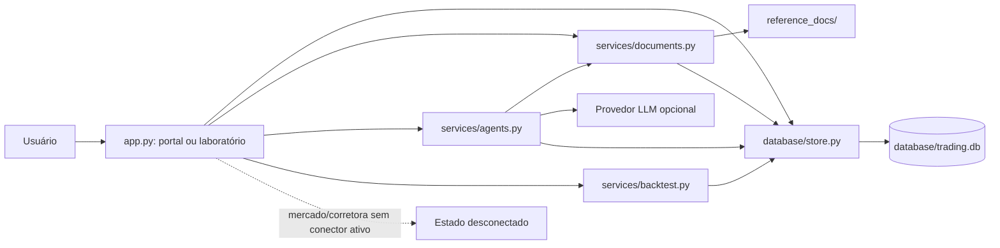

# Referência técnica — Trading Agent Lab

> Documentação do comportamento implementado e do estado observado até 17/11/2026. O código é a autoridade para implementação; `AGENTS.md` contém requisitos e decisões vigentes. Esta referência descreve o sistema existente e separa claramente o que ainda depende de dados, configuração ou decisão humana.

## 1. Visão geral

Trading Agent Lab é um aplicativo local em Python e Streamlit para organizar seis agentes de pesquisa intraday, registrar conhecimento e eventos, indexar PDFs localmente e avaliar estratégias sobre histórico OHLCV importado. O proprietário conserva seu histórico SQLite em `database/trading.db`; cada conta adicional usa um banco próprio em `database/workspaces/`.

O modo de operação é local e simulado. Não existe integração validada com corretora, não se envia ordem real e o aplicativo não fabrica cotação, saldo, P&L ou atividade para preencher a interface. As telas que dependem de dados ausentes mostram estados vazios ou integração desconectada.

O projeto tem duas apresentações:

1. **Portal de referência (padrão):** localiza para pt-BR a estrutura HTML de `referencia.html` e injeta dados locais, sem executar os carregadores externos do HTML original.
2. **Laboratório Streamlit:** selecionado após login; oferece os fluxos locais de perfil do agente, documentos, memória, revisão, tarefas, estratégias, CSV/backtest, operações simuladas e conexões.

## 2. Como executar

### Requisitos

- Windows 11 conforme o README atual.
- Python 3.11 ou superior.
- Dependências declaradas em `requirements.txt`: Streamlit (`>=1.49,<2.0`), pypdf (`>=5.1,<7.0`), websockets (`>=14,<18`) para o coletor público Binance e python-dotenv (`>=1.0,<2.0`) para carregar `.env` local.

### Instalação

```powershell
python -m venv .venv
.\.venv\Scripts\Activate.ps1
python -m pip install --upgrade pip
pip install -r requirements.txt
```

Se a política do PowerShell impedir a ativação, o README documenta `Set-ExecutionPolicy -Scope Process -ExecutionPolicy Bypass` para a sessão atual.

### Comandos suportados

```powershell
python main.py status
python main.py test
python main.py dashboard
```

- `status` inicializa/verifica o armazenamento pelo `database.store.initialize()` e imprime nome, estado e responsabilidade dos agentes persistidos.
- `test` executa a descoberta `unittest` em `tests/`.
- `dashboard` inicia Streamlit em `app.py`, sem coleta de estatísticas de uso do navegador.
- O atalho `iniciar_trading_lab.bat` executa `python main.py dashboard` a partir da pasta do projeto.
- O endereço padrão do portal é `http://127.0.0.1:8501`. No primeiro acesso, cadastre o proprietário e entre. Depois do login, escolha Portal ou Laboratório na navegação.

## 3. Organização do código

| Caminho | Responsabilidade observada |
|---|---|
| `main.py` | CLI com os comandos `status`, `test` e `dashboard`; inicializa o armazenamento. |
| `app.py` | Portal padrão, localização da referência HTML e interface Streamlit do laboratório. |
| `database/store.py` | Única camada de acesso SQLite; inicialização/migrações idempotentes e operações de leitura/escrita. |
| `database/trading.db` | Workspace legado do proprietário, preservado. |
| `database/identity.db`, `database/global_knowledge.db` | Contas locais e conhecimento comum promovido, respectivamente. |
| `database/workspaces/`, `database/vault/` | Bancos isolados das demais contas e cofres cifrados por usuário. |
| `services/auth.py`, `services/credential_vault.py`, `services/global_knowledge.py` | Login local, segredos individuais e promoção controlada de conhecimento comum. |
| `services/documents.py` | Descoberta, hash, extração local de PDFs, divisão em trechos e seleção de contexto autorizado. |
| `services/agents.py` | Configuração e chamada explícita a provedor compatível com OpenAI Chat Completions; registro das execuções. |
| `services/backtest.py` | Validação/importação de CSV OHLCV e motor histórico de cruzamento de médias simples. |
| `reference_docs/shared/` | PDFs comuns disponíveis à biblioteca local. |
| `reference_docs/agents/<slug>/` | Local reservado para documentos específicos de cada agente. |
| `referencia.html` | Referência estrutural/visual do portal. O portal trabalha sobre uma cópia em memória e não modifica este arquivo. |
| `trading-office-preview.html`, `trading-lab-preview.html` | Artefatos de referência/protótipo local; não são bancos de dados nem fonte de resultados de mercado. |
| `tests/` | Testes unitários de UI, serviços e persistência. |
| `static/` | Fontes locais Archivo e Doto e seus arquivos de licença. |
| `.streamlit/config.toml` | Configuração local do Streamlit. |
| `.env.example` | Nomes de variáveis de ambiente esperadas; não deve conter chaves reais. |

## 4. Arquitetura e fluxo de dados



O caminho normal de persistência passa por `database/store.py`. A UI chama serviços para as operações especializadas; a UI não abre uma conexão de mercado. A camada de documentos lê os PDFs locais e guarda índice e trechos no SQLite. O serviço de agentes só acessa o provedor durante a execução explícita de uma tarefa configurada.

### Pipeline de orquestração de agentes (Entrega 7)

`services/pipeline.py` encadeia automaticamente 7 estágios sobre o feed ao vivo (`market_bars`), sem exigir clique por etapa, e persiste a trilha completa mesmo quando um estágio não roda:

| # | Estágio | Natureza | Fonte |
|---|---|---|---|
| 1 | Market | serviço (`services/market_data.py`) | feed ao vivo Binance (`market_bars`) |
| 2 | Knowledge | serviço — Research Agent é a fonte | `knowledge_items` aprovados |
| 3 | Backtest Evidence | serviço, reaproveita Entregas 5/6 | `services/setup_backtest.py`, `services/validation.py` |
| 4 | Fundamental | agente existente (Fundamental Analyst) | sem fonte integrada (sempre `sem_fonte`) |
| 5 | Decision | serviço determinístico (`services/decision.py`) | combina os estágios 1–4; nunca vira registro em `agents` |
| 6 | Risk | agente existente (Risk Manager), `services/risk.py` | parâmetros de projeto (1R/3R/2 posições) + proveniência por campo |
| 7 | Execution | agente existente (Execution Agent), `services/execution.py` | portão humano de quantidade → `paper_operations` |

Decision e Knowledge nunca ganham registro próprio em `agents`/tela Sala: são função/serviço interno ao pipeline (decisão do usuário, não inflar a lista de agentes). A idempotência é por barra de sinal: `(strategy_id, symbol, timeframe, signal_bar_utc)` é `UNIQUE` em `pipeline_runs`, então reavaliar a mesma barra nunca produz uma segunda trilha. Execution para no portão humano (`status='aguardando_quantidade'`) até alguém informar a quantidade na tela; só então `services/execution.confirm_open` abre a posição real em `paper_operations`. Fechamento e cálculo de P&L ficam fora do escopo desta entrega. Detalhe completo da decisão: `../_capsule/decisoes/DEC-2026-11-16-escopo-entrega-7-orquestracao.md`.

## 5. Interface e áreas disponíveis

### 5.1 Portal padrão

O portal usa o esqueleto de `referencia.html`, troca os rótulos em espanhol por rótulos pt-BR, atualiza a marca para Trading Agent Lab e injeta registros consultados localmente. O HTML de referência é preservado no disco. O código não executa os carregadores GitHub/Kraken que existiam na referência.

O portal mostra cabeçalho/métricas, navegação lateral, vistas de sala, lista/resumo de agentes, painéis de estado, ticker de eventos locais e as vistas de Laboratório e Evolução do capital. Agentes, documentos, eventos e contagens vêm do SQLite. Recursos sem registros não são completados com exemplos fictícios.

### 5.2 Laboratório (`?lab=1`)

O laboratório oferece cinco áreas de navegação e quatro vistas de espaço de trabalho:

| Área | O que faz / estado atual |
|---|---|
| **Agentes** | Lista os seis registros locais, apresenta perfil e permite ver visão geral, conhecimento/documentos, memória, revisão e execução de tarefa. |
| **Mercado** | Feeds cripto persistidos com estado/frescor, snapshots Binance e históricos Market History/Alpaca IEX de ações com fonte, período e hash; distingue histórico de feed atual. |
| **Operações** | Lista paper trades persistidos, separados de eventos de sistema; vazio quando não há operações conciliadas. |
| **Informe** | Resumo factual de contagens/estado e resultados persistidos; não fabrica análise ou retorno. |
| **Controle** | Mostra proteções, biblioteca de documentos, configuração do provedor e conexões; identifica itens não configurados. |

As vistas do espaço de trabalho são:

- **Sala:** sala de analistas com cinco postos e sala de execução separada com um posto. A estação de execução só seleciona `Execution Agent`; a recepção de ordens permanece bloqueada. Desktop e variante compacta são renderizados por SVG local.
- **Laboratório:** cadastro/revisão/aprovação de estratégias e importação/execução de backtest histórico.
- **Orquestração (Entrega 7):** avalia automaticamente, ao abrir a aba, cada estratégia aprovada × símbolo elegível × timeframe do próprio setup sobre o feed ao vivo, com botão "Avaliar agora" para forçar nova checagem. Mostra a trilha de 7 estágios, o veredito do Risk Manager com a proveniência de cada checagem e o portão humano de quantidade (abrir posição simulada ou descartar candidato) para cada run `aguardando_quantidade`. Lista o histórico completo de runs com estágios, checagens de risco e relatório JSON para auditoria.
- **Evolução do capital:** baseada somente em operações simuladas encerradas; não infere capital inicial. Sem registros, mostra estado vazio.

A interface segue o tema escuro fixo da referência, tem uma rolagem vertical do documento e adapta a sala para caber na largura disponível. A sala mantém suas mesas legíveis e não cria uma rolagem horizontal na página.

### 5.3 Perfis e fluxos de agente

No perfil de cada agente, as abas cobrem:

- **Visão geral:** estado, responsabilidade e eventos.
- **Conhecimento:** documentos comuns e documentos com escopo do agente, com origem/página; indica arquivos ausentes, desatualizados ou com erro.
- **Memória:** criação de nota como proposta e revisão humana para aprovação ou rejeição.
- **Revisão:** observação, hipótese e aprendizado proposto ligado opcionalmente a evento; a promoção exige aprovação.
- **Tarefa:** execução sob demanda; mostra resultado/erro e grava estado da execução.

Não há execução automática em segundo plano. A chamada de tarefa é iniciada pelo usuário no formulário correspondente.

## 6. Os seis agentes e o estado observado

Os nomes, estados e responsabilidades são inicializados em `database/store.py` e mantidos na tabela `agents`. A tela lê os registros; não simula atividade. O banco consultado em 13/11/2026 continha:

| Agente | Estado persistido observado | Responsabilidade registrada |
|---|---|---|
| Research Agent | Revisão humana pendente (após a Entrega 2) | Extrai conceitos e setups dos PDFs. |
| Market Analyst | Aguardando dados | Analisa mercado quando houver feed conectado. |
| Fundamental Analyst | Aguardando dados | Analisa notícias, eventos e fundamentos. |
| Strategy & Backtest | Aguardando setups | Formaliza regras e executa backtests. |
| Risk Manager | Limites pendentes de revisão | Aguarda limites documentados; bloqueia propostas sem evidência e exige revisão humana. |
| Execution Agent | Simulação local apenas | Recebe propostas aprovadas; conector de negociação permanece bloqueado. |

Na captura histórica desta seção, o Research Agent ainda aparecia como `Aguardando documentos`, embora dois PDFs estivessem indexados. A Entrega 2 substitui esse comportamento por sincronização auditada ao iniciar o app, reindexar ou extrair conhecimento.

## 7. Persistência SQLite

O arquivo é `database/trading.db`; `database/store.py` configura `sqlite3.Row`, ativa chaves estrangeiras e realiza commit/rollback por contexto. `initialize()` cria tabelas com `CREATE TABLE IF NOT EXISTS`, sem descartar histórico, semear os seis agentes com `INSERT OR IGNORE` e aplica correções condicionais de estados/responsabilidades legados. O padrão de migração é aditivo e idempotente.

| Tabela | Conteúdo |
|---|---|
| `agents` | Nome único, estado e responsabilidade dos agentes. |
| `events` | Histórico temporal de eventos com agente, nível e mensagem. |
| `documents` | Caminho relativo, nome, SHA-256, estado, páginas, quantidade de trechos, data e erro. |
| `document_chunks` | Trechos do PDF associados ao documento e à página/índice. |
| `agent_runs` | Tarefa, resumo de contexto, saída, estado e horário. |
| `agent_memories` | Notas com tipo, fonte e estado `proposed`, `approved` ou `rejected`, além da revisão humana. |
| `knowledge_items` | Conceitos e setups versionados, evidência, fonte, hash, página e revisão humana. |
| `agent_reviews` | Observação, hipótese, aprendizado proposto, evento relacionado e estado de aprovação. |
| `strategies` | Regras JSON, origem, versão e estado `draft`, `approved` ou `archived`. Nome + versão são únicos. |
| `historical_datasets` | Arquivo, símbolo, intervalo, fonte declarada, SHA-256 do CSV, número de barras, manifesto JSON e SHA-256 canônico das barras. |
| `market_bars` | Candles fechados recebidos pelo coletor, separados dos snapshots históricos por fonte, símbolo, intervalo e horário. |
| `market_feeds` | Estado de conexão, último candle, última verificação e erro; a interface considera o registro atrasado quando o coletor não atualiza. |
| `historical_bars` | OHLCV histórico por dataset e timestamp; dataset + timestamp são chave primária. |
| `backtests` | Estratégia, ativo, intervalo, origem/hash dos dados, métricas JSON, estado e data. |
| `paper_operations` | Operações simuladas, lado, quantidade, preços, custo, fonte, estado aberto/encerrado/cancelado, `pipeline_run_id` (Entrega 7) ligando a posição à trilha que a autorizou, e `exit_reason` (Entrega 8, coluna aditiva: `stop`/`trailing_stop`/`target`/`entry_bar_ambiguous_stop`/`gap_boundary`/`end_of_data`) preenchido junto com `exit_price`/`closed_at` quando a condução fecha a posição. |
| `paper_journal` (Entrega 9) | Uma ficha por operação simulada, criada na abertura e completada na saída; preserva trilha, preços, custos, R líquido e limitações em `details_json`. |
| `paper_learning_proposals` (Entrega 10) | Hipóteses locais por coorte e digest de evidência, com observação, limitações, revisão humana e eventual nova versão `draft` vinculada. |
| `broker_paper_orders` (Entrega 11) | Intenções e respostas de ordens virtuais Binance Spot Testnet, separadas de `paper_operations`. Preserva run, papel entrada/saída, client ID único, preço/quantidade solicitados, preenchimento reconciliado, estado, horário e erro sanitizado; não guarda credenciais. |
| `pipeline_runs` (Entrega 7) | Uma linha por barra de sinal avaliada — `UNIQUE(strategy_id, symbol, timeframe, signal_bar_utc)` garante que a mesma barra nunca gera uma segunda trilha. Guarda decisão, veredito de risco, status do portão humano (`aguardando_quantidade`/`posicao_aberta`/`expirado`/...), risco comprometido (`risk_committed_r`), `pending_since` (início da janela de ~15 min de expiração) e o relatório completo em `report_json`. A coluna `realized_r` existe desde a Entrega 7 mas só passa a ser preenchida de verdade na Entrega 8, quando a condução fecha a posição ligada ao run (retorno líquido em R, já descontado o custo de fechamento). |
| `pipeline_stages` (Entrega 7; estágio 8 adicionado na Entrega 8) | Um registro por estágio por run, mesmo quando o estágio não roda (`nao_aplicavel`/`nao_executado`). Os estágios 1 a 7 (Market → Knowledge → Backtest Evidence → Fundamental → Decision → Risk → Execution) vêm da Entrega 7; a Entrega 8 acrescenta o estágio 8 ("conduction", agente "Execution Agent"), gravado por `services/trade_management.py` só quando a condução efetivamente fecha a posição (nunca enquanto ela segue `em_curso`), com resumo, entrada/saída (`input_json`/`output_json`, incluindo resultado bruto vs. líquido do fechamento) e limitações (`limitations_json`) para auditoria completa. |
| `connections` | Provedor/estado/metadados de conectores, sem campo de chave secreta. |

### Snapshot consultado em 13/11/2026, após a Entrega 2

Consulta somente leitura ao banco local (não é promessa de estado futuro):

| Registro | Quantidade |
|---|---:|
| Agentes | 6 |
| Eventos | 25 |
| Documentos indexados/catalogados | 2 |
| Trechos de PDF | 338 |
| Execuções de agente | 0 |
| Memórias | 0 |
| Revisões | 0 |
| Conhecimento estruturado | 29 propostas (6 conceitos e 23 setups), 0 aprovadas |
| Estratégias | 0 |
| Backtests | 0 |
| Datasets OHLCV / barras | 0 / 0 |
| Operações simuladas | 0 |
| Conexões registradas | 0 |

Os dois documentos no banco são `reference_docs/shared/Oliver Velez/Apostila Oliver Velez.pdf` (311 páginas, 329 trechos) e `reference_docs/shared/Oliver Velez/Setups Complementar Op. OV Atualizada.pdf` (9 páginas, 9 trechos), ambos com estado `indexed` na consulta. O Research Agent está em `Revisão humana pendente`. Nenhum conteúdo integral de PDF é reproduzido nesta documentação.

## 8. Biblioteca de PDFs

1. Os arquivos comuns ficam em `reference_docs/shared/`; arquivos restritos por agente podem ficar em `reference_docs/agents/<slug>/`.
2. `discover_pdfs()` procura PDFs nos dois diretórios de referência.
3. `index_pdf()` recusa caminhos fora da raiz de documentos, calcula SHA-256, extrai texto com pypdf e divide texto por página em trechos. PDF protegido ou erro de extração é persistido como falha; documento sem texto extraível recebe estado `no_text`.
4. Se caminho e hash não mudaram e o estado anterior é indexável (`indexed`/`no_text`), a indexação é idempotente e retorna `unchanged`. Mudança de hash provoca reprocessamento.
5. `library_status()` compara o hash do arquivo atual ao registro e identifica ausência de índice (`pending`) ou índice desatualizado (`stale`).
6. `agent_context()` inclui apenas trechos frescos de documentos comuns e do diretório específico do agente, com escopo e limite de trechos. Documento com estado pendente, stale, failed ou no_text não entra no contexto.

A ação de indexação está no modo Laboratório, em **Controle**. A leitura e indexação são locais. Se o usuário optar por enviar trechos a provedor externo durante uma tarefa, a UI exige inclusão explícita dos documentos e confirmação/autorização; os arquivos originais não são enviados por simples indexação.

### Conhecimento estruturado e revisão humana (Entrega 2)

O fluxo novo fica no perfil do Research Agent, em **Conhecimento**. A ação “Extrair propostas dos PDFs indexados” executa somente lógica local e determinística; não chama provedor de IA. Ela usa páginas identificadas da apostila principal para conceitos e do suplemento para títulos de setups, guardando o trecho integral daquela página como evidência. A extração é idempotente para a mesma fonte e hash.

Cada registro em `knowledge_items` guarda tipo (`concept`/`setup`), título, versão, estado, caminho relativo, SHA-256, página, evidência, detalhes estruturados e dados de revisão (data e revisor). Uma mudança no hash cria nova versão da proposta; não reescreve a decisão anterior. Os status atuais são `proposed`, `approved` e `rejected`. Aprovar significa aceitar o registro como conhecimento revisado; não transforma setup em estratégia executável. O contexto respeita o escopo documental de cada agente e exclui fontes de outras pastas de agente.

Os 23 títulos do suplemento são descobertas (`DISCOVERED`) e ainda não têm formalizados todos os campos de regra, gatilho, invalidação, custos e contexto. A interface deixa isso explícito. Os seis conceitos iniciais também são propostas, não fatos de mercado. Revisão e rejeição são ações humanas explícitas, registradas em eventos. Propostas e rejeições nunca entram no contexto aprovado do agente. Conhecimento aprovado só entra quando o usuário inclui documentos na tarefa, a tarefa satisfaz o fluxo de autorização existente e o hash da fonte continua igual ao arquivo atual.

O status persistido do Research Agent é sincronizado a partir da situação local: aguarda documentos se nenhum PDF atual está indexado; aguarda extração quando há PDFs atuais mas nenhum item estruturado; indica revisão humana enquanto há propostas; e indica conhecimento revisado após a aprovação das propostas pendentes. Essa sincronização ocorre ao abrir o aplicativo, indexar a biblioteca e extrair propostas, e só grava evento quando o status muda. Fontes com hash divergente não alimentam contexto.

Para esta entrega, o catálogo de setups cobre páginas 1–5 e 7–9 do suplemento. A extração por catálogo não afirma que as demais páginas ou capítulos estejam completamente estruturados. Imagens, gráficos e tabelas não foram submetidos a OCR; o texto extraído depende do conteúdo textual do PDF. A revisão humana continua necessária para validar significado, completude e campos técnicos.

## 9. Provedor de IA e execução de tarefas

O conector em `services/agents.py` aceita endpoint compatível com OpenAI Chat Completions. Configuração pelo ambiente do processo:

| Variável | Uso |
|---|---|
| `TRADING_LAB_LLM_BASE_URL` | Base do endpoint compatível. |
| `TRADING_LAB_LLM_MODEL` | Identificador do modelo. |
| `TRADING_LAB_LLM_API_KEY` | Chave para endpoint externo; pode ficar vazia em endpoint local, quando suportado. |

Um endpoint local documentado como exemplo é `http://localhost:11434/v1`; provedores externos devem usar HTTPS. A chave não aparece na UI nem é persistida em SQLite. Sem base URL e modelo, o serviço não chama o provedor e informa que a integração está indisponível. O endpoint passa por validação antes da chamada.

Fluxo de tarefa: validar configuração e autorização; montar contexto permitido (memória aprovada e, se autorizado, trechos documentais atuais); registrar início; fazer chamada explícita; gravar saída ou falha como execução e evento. Memórias propostas/rejeitadas não fazem parte do contexto aprovado. Não há polling nem agente rodando em background.

Nenhum provedor está configurado no snapshot consultado; portanto, nenhuma execução estava registrada naquele momento.

## 10. Memória, revisão e estratégia

- Uma nota criada por agente começa como proposta. Só uma aprovação humana muda seu estado para aprovado e permite uso em contexto futuro; rejeições permanecem no histórico.
- Uma revisão de erro guarda observação, hipótese e aprendizado sugerido, podendo apontar para um evento. Aprovar/rejeitar é ação humana.
- Estratégias são versionadas por nome e número de versão, armazenam regras em JSON e possuem estados de rascunho, aprovada e arquivada. Alteração cria versão, preservando anterior.
- O fluxo do laboratório só permite executar estratégia aprovada e requer confirmação dos custos informados.
- No banco do snapshot, não existiam memórias, revisões ou estratégias persistidas.

### Quatro setups selecionados na Entrega 3

O responsável selecionou VBS, VSS, BOP e BDP e aprovou os parâmetros v1 em 13/11/2026. `services/setup_specs.py` liga cada regra às páginas da apostila principal, à página 4 do suplemento e aos hashes atuais dos PDFs. O SQLite guarda quatro rascunhos na versão 1 e quatro versões aprovadas na versão 2; a versão anterior não foi reescrita. O catálogo documental agora contém 31 propostas, incluindo VBS e VSS.

| ID | Setup | Páginas principais | Regra operacional aprovada |
|---|---|---|---|
| `SETUP_01` | VBS | 101–102 | Tendência pela SMA20, três barras contrárias, entrada acima do setup, stop no extremo oposto, alvo de 50% da correção e trailing após dois fechamentos favoráveis. |
| `SETUP_02` | VSS | 111–112 | Par de venda do VBS, com as condições invertidas. |
| `SETUP_03` | BOP | 223–224, 230 | Base de 3 a 8 barras, compressão até 1,5 ATR20, volume inferior ao período anterior, SMA8 ascendente, entrada acima da base e alvo pela sua altura. |
| `SETUP_04` | BDP | 239–240 | Par de venda do BOP, com SMA8 descendente e entrada abaixo da base. |

Os números de três barras, oito barras, 1,5 ATR20 e a resolução de conflito intrabar pelo stop são parâmetros de implementação aprovados pelo usuário; não são números atribuídos aos PDFs. `services/setup_signals.py` avalia apenas barras fechadas e emite uma ordem hipotética válida para a barra seguinte, com entrada, stop e alvo. Não preenche a ordem nem calcula retorno. Se alvo e stop forem atingidos na mesma barra futura, o motor de backtest da Entrega 5 deverá aplicar a regra conservadora aprovada. A unidade de incremento mínimo, custos e horários ainda dependem do dataset e mercado da Entrega 4.

| Parâmetro aprovado | VBS/VSS | BOP/BDP |
|---|---|---|
| Timeframes iniciais | 2 e 5 minutos | 2 e 5 minutos |
| Tendência | SMA20 atual acima/abaixo da SMA20 de três barras anteriores | SMA8 atual acima/abaixo da SMA8 de três barras anteriores |
| Formação | Três barras de cor contrária ao lado da entrada | Base de 3 a 8 barras completas |
| Compressão e volume | Não obrigatórios nesta versão | Amplitude até 1,5 ATR20 anterior à base; volume médio inferior ao das 20 barras anteriores |
| Entrada | Ordem stop na barra seguinte, 1 tick além do extremo da barra de setup | Ordem stop na barra seguinte, 1 tick além do extremo da base |
| Stop | 1 tick além do extremo oposto da barra de setup | 1 tick além do extremo oposto da base |
| Alvo | Retração de 50% entre o extremo do setup e o extremo favorável das 20 barras anteriores; sinal rejeitado se o alvo não ultrapassar a entrada | Entrada mais/menos uma altura de base |
| Condução | Trailing pelo extremo da barra anterior após dois fechamentos favoráveis | Sem trailing nesta versão |
| Mesmo candle toca stop e alvo | Stop primeiro | Stop primeiro |

O stop conhecido antes da entrada substitui, nesta versão operacional, a alternativa da apostila baseada na barra de entrada. A alternativa de estrutura por máximas/mínimas para VBS/VSS fica para outra versão. A regra de horário espera mercado e fuso definidos. Cada backtest deverá informar incremento mínimo, comissão, spread e slippage; esses dados não são presumidos da apostila.

Prova da Entrega 3: `python main.py test` passou com 40 testes; `python -m py_compile` passou para app, banco e novos serviços. Playwright abriu o Laboratório em 1440×1000, 390×844 e 320×740, encontrou as quatro versões aprovadas, confirmou ausência do botão de backtest SMA para esses setups e não encontrou rolagem horizontal. O SQLite local registrou quatro rascunhos v1 e quatro versões v2 aprovadas. Nenhum dataset nem backtest foi criado.

## 11. CSV OHLCV e backtest

O serviço em `services/backtest.py` aceita CSV UTF-8 (com BOM permitido) contendo `timestamp,open,high,low,close,volume`; também reconhece `datetime`, `date` ou `time` como alias de timestamp. O delimitador é detectado entre vírgula, ponto e vírgula e tabulação.

Validações implementadas:

- arquivo não vazio, até 50 MB e até 500.000 barras;
- pelo menos três barras;
- timestamp ISO interpretável, único e estritamente crescente;
- não misturar timestamps com fuso e sem fuso;
- valores numéricos finitos; preços positivos e volume não negativo;
- consistência OHLC: máxima cobre open/close/low e mínima não supera open/close/high.

O SHA-256 do conteúdo identifica o dataset importado. Os dados e as barras são persistidos em SQLite com símbolo, intervalo e origem declarados.

O único motor implementado é um cruzamento de médias simples **long-only**:

1. Janela rápida deve ser pelo menos 2 e menor que a janela lenta.
2. Sinal é calculado no fechamento da barra; preenchimento acontece na abertura da barra seguinte.
3. Entrada ocorre no cruzamento para cima; saída no cruzamento para baixo. Posição remanescente é encerrada no fechamento da última barra.
4. Taxa e slippage são parâmetros em pontos-base por lado; são descontados em ida e volta.
5. Métricas incluem quantidade de trades, percentual de acerto, retorno líquido composto, drawdown máximo e custo estimado. O retorno não é anualizado.

Limitações deliberadas: não há benchmark, dividendos, capital inicial, alocação por quantidade, execução intraday real ou outros algoritmos. Resultado é retrospectivo/simulado e depende do CSV, origem, parâmetros e custos salvos; não representa promessa de retorno.

No snapshot local, não havia dataset, barra, estratégia nem backtest persistido.

## 12. Operações, mercado e corretora

- Eventos de sistema ficam em `events`; não são tratados como operações financeiras.
- Operações simuladas ficam em `paper_operations`, com quantidade/preço positivos, taxa não negativa e estados `open`, `closed` ou `cancelled`. O capital usa operações encerradas e não supõe saldo inicial.
- A tela de Mercado representa criptoativos e ações dos EUA sem feed, até que fonte específica e verificável seja configurada.
- XP Trader **5.0.4.34** aparece como não conectado. Não se presume compatibilidade com Profit Pro/Ultra nem que ProfitDLL cubra a licença ou ativos necessários.
- A investigação específica da Entrega 12 está em `docs/integrations/xp-trader-5.0.4.34.md`: matriz de dados, API, SDK, simulação, execução e limitações com fontes oficiais. ProfitDLL é produto licenciado separadamente; suas capacidades genéricas não confirmam direito de uso na licença XP Trader do usuário.
- Integração XP depende de confirmação de licença, documentação e SDK para a versão exata e conta de simulação. Nenhuma ordem é encaminhada no escopo atual.
- Conexões mostram estado e requisitos; segredos não são armazenados em SQLite. Provedores externos só são chamados por ação explícita.

No snapshot local não havia operações nem conexões registradas.

## 13. Responsividade e interação

O portal injeta estilos e dados locais sobre a referência sem editar `referencia.html`. Em desktop, a sala principal usa SVG com seis estações; o seletor separa cinco analistas do agente de execução. A variante compacta redesenha a sala para pequenas larguras, mantendo painéis legíveis. A página foi ajustada para uma rolagem vertical do documento, sem overflow horizontal da página.

Uma run de 12/11 registra uma inspeção de seleção de mesa, alternância entre Sala/Laboratório e renderização em 390×844 e 320×740, além de compilação Python. Essa prova documenta aquela rodada, não substitui validação após alterações futuras. A exigência vigente também inclui 1440×1000; não declarar cobertura atual além do que cada run comprova.

## 14. Testes existentes e prova

Os testes estão divididos em:

- `tests/test_store.py`: agentes iniciais, inicialização idempotente, eventos, migração de estado legado, memória e revisão humana, versionamento de estratégia.
- `tests/test_services.py`: indexação local/idempotente de PDF, limite de caminho, escopo de contexto, detecção de hash stale, configuração/consentimento do provedor, registro de tarefas, CSV e resultados do motor SMA.
- `tests/test_app.py`: portal localizado com dados persistidos, separação entre eventos e trades, áreas/vistas, sala de execução, ausência de dados fictícios, memória e revisão.

Entrega 2 acrescenta provas de migração aditiva, deduplicação de propostas, versionamento por hash, citações de página e filtragem de contexto para conhecimento aprovado. A execução atual da suíte será registrada na run desta entrega.

O comando de prova do projeto é `python main.py test`. Na Entrega 2, 35 testes passaram. `python -m py_compile app.py database/store.py services/documents.py services/knowledge.py services/agents.py` também passou. A verificação Playwright abriu a biblioteca e confirmou citação, botão de aprovação e ausência de rolagem horizontal em 1440×1000, 390×844 e 320×740. A run de 12/11 documenta uma rodada visual anterior e não substitui essas provas.

## 15. Segurança e privacidade

- O uso esperado é local e em simulação; nenhuma ordem real deve ser preparada ou enviada.
- PDFs são processados localmente por padrão. Só contexto explicitamente selecionado e autorizado pode seguir a um LLM externo durante uma tarefa.
- No portal autenticado, chaves de provedor vêm apenas do cofre cifrado do usuário ativo. O modo CLI legado ainda pode usar variáveis de ambiente. Segredos não entram em SQLite, logs, Markdown ou commits.
- Não colocar credenciais, extratos ou dados pessoais em `reference_docs/`.
- Eventos e falhas podem conter textos de operação. Não os copie para documentação ou logs externos sem revisar conteúdo.
- `database/trading.db` guarda dados e histórico locais; faça cópia/backup de forma operacionalmente controlada antes de qualquer manutenção manual. Não edite o banco diretamente: use a camada `database/store.py`.

## 16. Estado concluído e trabalho em aberto

### Implementado no código

- Portal padrão localizado baseado na referência HTML com dados locais do SQLite.
- Laboratório Streamlit selecionável após login.
- Seis agentes persistidos, eventos e painéis alimentados pelos dados locais.
- Persistência SQLite para documentos/trechos, tarefas, memórias, revisões, estratégias, datasets, barras, backtests, operações e conexões.
- Indexação local de PDFs com hash, páginas, trechos, status/erro e filtragem do contexto por agente.
- Conector opcional de LLM com chamada explícita e fluxo de consentimento para contexto documental.
- Revisão humana de memória/aprendizado e estratégia versionada/aprovável.
- Importação CSV OHLCV com manifesto obrigatório, lacunas, hash duplo, reprodução verificada e backtest SMA histórico com custos explícitos.
- Captura explícita de BTCUSDT e ETHUSDT públicos Binance Spot; coletor separado para candles fechados de 1 minuto com reconexão e backfill.
- Painéis vazios/desconectados para mercado, capital, operações e integrações ausentes.
- Separação visual da sala de execução, bloqueio de ordens reais e layout responsivo da referência.
- Validation Engine com corte temporal causal treino/out-of-sample, grade fixa de custo, concentração pelo melhor trade e rótulo de adequação da amostra persistido em `validation_runs`, refletido nos dois modos de portal.
- Orquestração automática de agentes (Entrega 7): pipeline de 7 estágios (Market → Knowledge → Backtest Evidence → Fundamental → Decision → Risk → Execution) disparado sozinho ao abrir a aba Orquestração, com trilha auditável persistida em `pipeline_runs`/`pipeline_stages`, Risk Manager com parâmetros de projeto (1R por trade, 3R de perda diária, 2 posições simultâneas) e portão humano de quantidade que abre posição real em `paper_operations`.
- Condução de posição simulada (Entrega 8): `services/trade_management.py` reconduz, sob demanda e do zero a cada abertura de tela, cada `paper_operation` aberta — stop/alvo/trailing reproduzidos bit a bit do motor do backtest (`services/setup_backtest.py::replay_open_position`, extraída de `simulate` sem mudar seu comportamento) a partir da barra de entrada congelada na trilha. Fecha a posição com `exit_reason`/`exit_price`/`closed_at` em `paper_operations` e `realized_r` em `pipeline_runs`, grava o estágio 8 ("conduction") em `pipeline_stages`, e dispara nos dois modos de portal (padrão e Laboratório) toda vez que a tela de Orquestração/posições abre. `python -m scripts.run_delivery8` demonstra o critério de aceite: paridade de motor sem banco e o fluxo completo com persistência e idempotência num banco temporário.
- Ciclo paper completo (Entrega 9): a abertura cria `paper_journal` com uma ficha por operação; o fechamento completa a ficha com saída, premissas de custo, taxas simuladas, P&L líquido em USDT e resultado líquido em R. Operação, `pipeline_runs.realized_r`, diário e estágio de condução são concluídos na mesma transação. O portal padrão e o Laboratório mostram o diário e estados vazios. `python -m scripts.run_delivery9 --prova` demonstra sinal, risco, entrada humana, condução, saída e diário em banco temporário com candles sintéticos.
- Aprendizado controlado (Entrega 10): `services/paper_learning.py` analisa localmente apenas operações paper encerradas com trilha e diário íntegros. O mínimo de projeto é 30 operações da mesma estratégia/símbolo/intervalo em dois dias UTC; a proposta guarda IDs e digest SHA-256. Revisão humana é explícita; nova versão, se criada, começa como rascunho não executável. Com zero operações paper no banco local em 17/11/2026, nenhuma hipótese real foi gerada.
- Broker Paper (Entrega 11): `services/brokers/base.py` define a interface e `services/brokers/binance_spot_testnet.py` acessa somente o host fixo da Binance Spot Testnet. `services/broker_paper.py` exige candidato BUY autorizado, quantidade e preço LIMIT do usuário, filtros e cotação recente da Testnet e confirmação humana. `broker_paper_orders` registra a intenção antes do POST; timeout é `unknown` e exige consulta, sem reenvio automático. Compra, consulta, cancelamento e venda de saída manual são ações separadas; saída não excede quantidade comprada reconciliada. Não há stop automático, saldo ou P&L da Testnet agregados ao paper local. Sem credenciais exclusivas, a conexão permanece desconectada. A renderização das telas não chama endpoints privados.
- Multiusuário local (Entrega 13): o primeiro cadastro cria o proprietário e preserva seu banco legado. Outras contas são criadas somente pelo proprietário e recebem bancos próprios. Portal e Laboratório exigem login. PDFs particulares são separados por usuário; itens comuns só entram na base global após aprovação, promoção explícita e verificação do hash. Credenciais individuais ficam cifradas fora do SQLite e não herdam o `.env` do processo na sessão autenticada.

### Ainda não conectado, sem dados ou dependente de decisão

- Escolher/configurar provedor LLM e autorizar por provedor quais dados podem ser compartilhados.
- Para ações dos EUA em tempo real, implementar e validar um coletor próprio; os snapshots Market History e Alpaca IEX disponíveis neste ambiente são históricos, sem streaming de ações.
- Confirmar licença, documentação e SDK do XP Trader 5.0.4.34, direitos de dados e conta exclusivamente simulada roteável antes de qualquer integração; ver matriz da Entrega 12.
- Definir/implementar o fluxo operacional de registro de operações simuladas conforme os dados e regras que forem aprovados; a tabela e a apresentação existem, mas o snapshot tem zero operações.
- Avaliar os quatro setups em janelas independentes e mais longas; a demonstração da Entrega 5 usa apenas cerca de 16h38 de candles de cada par e não sustenta inferência estatística. Enquanto isso não mudar, a validação da Entrega 6 continuará rotulando essas combinações como amostra insuficiente — o rótulo é o resultado correto, não um defeito a corrigir no código.
- Comparar períodos e procurar degradação, itens da seção 10 do roadmap deixados explicitamente fora da Entrega 6: ambos exigem várias janelas longas e independentes que o histórico atual não oferece. Dependem de coleta contínua mais longa, não de implementação.
- Revisar manualmente conceitos e setups propostos; aprovação não formaliza estratégia executável nem autoriza backtest ou operação.
- Registrar execuções de agentes e avaliar seus resultados somente depois que o provedor e o contexto estiverem autorizados.
- `mercado_fora_das_regras` (`filters.session_hours`) permanece sem fonte definida de mercado/fuso; na trilha da Entrega 7 ele fica marcado `nao_aplicavel` e nunca bloqueia nem libera nada.
- O estágio Fundamental da Entrega 7 está sempre `sem_fonte`: nenhuma fonte de notícias/eventos foi integrada ao projeto.
- Fechamento de posição e cálculo de P&L ficam fora do escopo da Entrega 7; ela só abre a posição simulada em `paper_operations`, sem rotina de acompanhamento/saída automática. **Passa a ser escopo da Entrega 8** (ver abaixo), com as limitações próprias dela.
- Entrega 8: uma posição `open` que já deveria ter fechado (bateu stop/alvo) só fecha quando alguém abre a tela de condução — se ninguém abrir, ela continua `open` mesmo tendo batido o stop há horas; isso é limitação conhecida, não bug. A condução continua dependente do coletor Binance estar rodando (mesma dependência já aceita para o sinal na Entrega 7, agora também para conduzir posição aberta). A inconsistência entre `rules_json.management` (dado declarado) e o comportamento real de trailing (hardcoded por nome de setup) agora existe em DOIS motores (backtest e paper engine), não corrigida nesta entrega — candidata a correção numa entrega futura dedicada.

## 17. Rastreabilidade

### Entrega 13: Multiusuário local

Plano aprovado em `docs/plans/entrega-13-multiusuario.md`. `database/store.py` resolve o banco por contexto de usuário e conserva `database/trading.db` como workspace do proprietário. `identity.db` guarda identificador, papel e verificador Argon2id; `global_knowledge.db` guarda apenas itens comuns promovidos. O cofre por usuário usa AES-GCM com chave derivada da senha e salt individual. Recarregar a página exige novo login; não há recuperação de senha nesta entrega. `main.py dashboard` escuta apenas `127.0.0.1`. Esta autenticação local não é publicação online; TLS, cookies, recuperação e operação em múltiplas instâncias pertencem à Entrega 14.

`python -m scripts.run_delivery13 --prova` demonstrou dois usuários, bancos isolados, conhecimento comum e cofre sem rede ou alterações no banco real. `python -m scripts.check_delivery13_ui` verificou login, Portal e Laboratório em 1440×1000, 390×844 e 320×740 sem rolagem horizontal. `python main.py test` concluiu 157 testes com `OK`; `python main.py status` preservou os seis agentes do banco legado. O histórico do proprietário continua no banco legado; conectar LLM, Alpaca IEX ou Binance Spot Testnet exige cadastrar novamente as credenciais no cofre pessoal, além das ações e confirmações já exigidas pelos respectivos fluxos.

### Entrega 12: Investigação XP Trader 5.0.4.34

Plano `docs/plans/entrega-12-xp-trader.md` aprovado pelo usuário em 17/11/2026. `docs/integrations/xp-trader-5.0.4.34.md` registra, por tema, evidência pública, conclusão limitada à versão/licença informada e perguntas de validação para Nelogica/XP. As fontes oficiais identificam XP Trader como White Label, ProfitDLL como produto separado e recursos genéricos de dados/roteamento para B3. Não foi obtida matriz de compatibilidade da licença XP Trader 5.0.4.34 com a DLL, SDK aplicável nem confirmação de que uma conta simulada XP seja roteável. Isso é ausência de evidência neste ambiente, não prova de inexistência. O estado XP continua desconectado e nenhum código de conexão, login, feed ou envio XP foi criado. BTCUSDT/ETHUSDT e AAPL/MSFT mantêm as fontes próprias já documentadas.

Provas: `python main.py test` passou com 150 testes antes da investigação. Após a atualização documental, `python main.py test`, `python main.py status` e inspeção do diff confirmam que o comportamento executável e os seis agentes persistidos não mudaram. A Entrega 13 não foi iniciada.

### Entrega 11: Broker Paper

Plano `docs/plans/entrega-11-broker-paper.md` aprovado pelo usuário em 17/11/2026. O adaptador usa apenas `https://testnet.binance.vision` e chaves `BINANCE_SPOT_TESTNET_API_KEY`/`BINANCE_SPOT_TESTNET_API_SECRET` no ambiente ou `.env` ignorado, sem gravá-las no SQLite. `exchangeInfo` valida preço, quantidade e valor mínimo; `bookTicker` fornece cotação própria da Testnet com frescor máximo de 30 segundos e limite de divergência de 1%. A UI pede consulta e confirmação específicas para compra LIMIT e venda LIMIT manual. Uma intenção ocupa o run antes de enviar, impedindo dupla abertura local/Testnet. Estados `unknown` permanecem reservados até consulta; preenchimento não é presumido. A Testnet externa pode resetar, e a ausência de ordem remota deve ser tratada por reconciliação humana antes de novo candidato. A compra virtual preenchida fica sem stop automático até a venda preencher.

`python -m scripts.run_delivery11 --prova` percorreu intenção, timeout, consulta, compra e saída com adaptador falso e banco temporário, sem rede. `tests/test_broker_paper.py` cobre assinatura e host fixo, filtros, falta de chaves, portão humano, idempotência, timeout, reconciliação, cancelamento, limite de saída e short inelegível. `python main.py test` passou com 150 testes; `scripts/check_delivery9_ui.py` verificou o bloco Testnet no portal e no Laboratório em 1440×1000, 390×844 e 320×740, sem erro de JavaScript ou rolagem horizontal. `python main.py status` aplicou a migração idempotente preservando os seis agentes. Conexão e ciclo de ordem externa não foram verificados: as credenciais Testnet não estão presentes neste ambiente, e nenhuma ação de envio externo foi iniciada. Nenhum resultado externo é afirmado.

### Entrega 10: Aprendizado Controlado

Plano `docs/plans/entrega-10-aprendizado-controlado.md` aprovado pelo usuário em 17/11/2026. O analisador determinístico `services/paper_learning.py` consulta operações paper fechadas com diário, trilha autorizada, estágio de condução e resultado líquido coerentes. Agrupa por `strategy_id`, símbolo e intervalo. O limiar de 30 operações em pelo menos dois dias UTC é parâmetro de projeto aprovado para habilitar uma hipótese; não afirma robustez. Com menos evidência, retorna `insufficient` e não persiste proposta. O banco local tinha zero operações paper encerradas ao implementar, portanto a tela mostra estado vazio, sem exemplos fictícios.

`paper_learning_proposals` persiste versão do analisador, digest canônico SHA-256 dos campos usados, IDs das operações, observação, hipótese, limitações, estado de revisão e eventual rascunho vinculado. A unicidade `(strategy_id,symbol,timeframe,analyzer_version,evidence_sha256)` impede duplicata de análise idêntica. Aprovação/rejeição altera somente a proposta uma vez; não escreve memória de método nem muda regra. Para criar versão nova, o usuário edita manualmente apenas `pattern`, `entry`, `stop`, `target`, `management` ou `filters`. O serviço reconfere a evidência, preserva identidade e hashes das fontes e grava `strategies.status='draft'` com `rules_json.approval='paper_learning_draft_pending_review'`. A versão aprovada anterior não muda. O rascunho não passa pelos portões de backtest/pipeline até revisão e aprovação futura das regras.

A vista Orquestração do Laboratório mostra contagem de cada coorte, ação explícita para gerar hipótese quando elegível, revisão e formulário de rascunho. O portal padrão mostra apenas resumo persistido e ausência de propostas. Não há LLM, envio de PDF, otimização automática nem conexão de corretora nesta entrega. O trailing por nome de setup permanece limitação conhecida; editar `management` no rascunho não muda o motor atual.

Provas em 17/11/2026: `python main.py test` passou com 142 testes. `tests/test_paper_learning.py` cobre 0/29/30 operações, dois dias UTC, isolamento por símbolo, digest, idempotência, aprovação, rejeição, integridade antes do rascunho, bloqueio de nova versão executável e ações de revisão/rascunho pela UI. `python -m scripts.run_delivery10 --prova` percorreu o fluxo em banco temporário e com operações sintéticas. `scripts/check_delivery9_ui.py` verificou portal e Laboratório em 1440×1000, 390×844 e 320×740, incluindo o bloco de aprendizado, sem erro de JavaScript ou rolagem horizontal. `python main.py status` aplicou a migração aditiva ao banco local preservando os seis agentes; o banco permaneceu com zero diários e zero propostas paper após a prova.

### Entrega 9: Paper Trading

Plano aprovado pelo usuário em 17/11/2026: `docs/plans/entrega-9-paper-trading.md`. O ciclo reutiliza o pipeline da Entrega 7 e a condução da Entrega 8. `database/store.py` cria `paper_journal` por migração aditiva, gera uma ficha na abertura e completa a mesma ficha ao fechar. Na primeira inicialização após a migração, operações anteriores são identificadas como legadas com apenas os campos persistidos; sinal, decisão e condução ausentes não são inventados. O fechamento condicional permanece idempotente; operação, `pipeline_runs.realized_r`, diário e estágio 8 são gravados na mesma transação. Evento informativo vem depois do commit.

Na operação paper, `services/trade_management.py` usa 10 bps de taxa por lado e 5 bps de slippage adverso na saída. O slippage já está no `exit_price`; a taxa de entrada é `entry_price × quantity × 10/10000` e a de saída é `exit_price × quantity × 10/10000`. `paper_operations.fees` guarda a soma, e `realized_r` é o P&L líquido dividido por `abs(entry_price - stop_inicial) × quantity`. A Evolução do capital agrega apenas BTCUSDT/ETHUSDT e rotula o total em USDT; outras moedas ficam fora desse agregado. O backtest histórico mantém sua fórmula anterior de taxa de ida e volta sobre o preço de entrada; seu retorno percentual pode, portanto, diferir ligeiramente do cálculo monetário paper, que usa os dois nocionais efetivos. Isso não altera relatórios históricos persistidos.

A condução continua sob demanda: sem abrir a tela ou executar replay, uma posição pode continuar aberta após o stop ser atingido nos candles. Não há corretora paper externa, ordem real, processo novo de acompanhamento, validação estatística nova ou promoção automática de estratégia. O trailing segue a regra conhecida por nome do setup, sem ler `rules_json.management` para decidir.

Provas em 17/11/2026: `python main.py test` passou com 135 testes; `python -m scripts.run_delivery9 --prova` percorreu o ciclo em banco temporário, negou candidato concorrente por exposição, fechou por stop e confirmou diário único e reconciliação de taxas/P&L/R. `python -m scripts.run_delivery8 --prova` manteve a paridade do motor e a idempotência anteriores. `scripts/check_delivery9_ui.py` verificou portal e Laboratório em 1440×1000, 390×844 e 320×740, sem erro de JavaScript ou rolagem horizontal. `python main.py status` aplicou a migração aditiva ao banco local sem alterar os seis agentes. Nenhum resultado sintético da prova foi persistido em `database/trading.db`.

### Entrega 8: Trade Management

A decisão completa está em `../_capsule/decisoes/DEC-2026-11-16-escopo-entrega-8-trade-management.md`; o que segue resume fielmente os pontos relevantes para quem lê só esta referência.

**Condução sob demanda, sem processo novo.** Sempre que o usuário abre a tela correspondente (ou roda `python -m scripts.run_delivery8`), `services/trade_management.replay_open_operations()` reprocessa, do zero, todas as `market_bars` desde a entrada de cada `paper_operation` aberta e decide, nesse momento, se ela deveria ter fechado — mesmo padrão sob demanda já usado pelo pipeline da Entrega 7, sem processo em background novo (o único precedente de processo contínuo no projeto continua sendo o coletor Binance). Consequência aceita explicitamente: uma posição só fecha quando alguém olha a tela.

**Trailing replicado tal como está, inconsistência incluída.** `services/setup_backtest.py::replay_open_position` foi extraída de dentro de `simulate` sem mudar nenhum comportamento existente (mesmo padrão de extração sem alterar resultado já usado na Entrega 6 com `verify_approved_rules`/`prepare_verified_run`), e é chamada tanto pelo backtest quanto por `trade_management.replay_operation`. A regra de trailing protetivo decide por nome de setup (`rules["setup_name"] in {"VBS", "VSS"}`), não pelo campo `rules_json.management` feito para isso — `management` é lido em `trade_management.py` só para auditoria (expor, não corrigir, a inconsistência) e nunca passado ao motor. Os dois motores ficam idênticos bit a bit na regra de trailing; a inconsistência entre o campo declarado e o comportamento real passa a existir em dois lugares em vez de um, registrada aqui e na seção 16 como limitação conhecida.

**Onde mora o resultado do fechamento.** `paper_operations` ganhou a coluna aditiva `exit_reason` (`stop`/`trailing_stop`/`target`/`entry_bar_ambiguous_stop`/`gap_boundary`/`end_of_data` — a persistência rotula `trailing_stop` quando o stop foi arrastado antes de fechar por stop, distinção feita na camada de persistência, não no motor, que devolve `"stop"` nos dois casos) e passa a ter `exit_price`/`closed_at` preenchidos de verdade. `pipeline_runs.realized_r` (coluna já existente desde a Entrega 7, sempre `NULL` até aqui) recebe o retorno em R. `database/store.close_paper_operation` faz isso com um UPDATE condicional (`WHERE state='open'`) que nunca sobrescreve um fechamento concorrente e estampa `realized_r` na mesma transação. Nenhum valor monetário novo entra no esquema — o resultado oficial continua em R, mesma unidade da Entrega 7.

**Barra de entrada congelada, nunca `rules_json` reaberto.** A condução usa o preço/stop/alvo já congelados em `report_json["execution"]` da trilha e o `entry_price` que o humano realmente confirmou — nunca os parâmetros atuais de `strategies.rules_json`, que podem ter mudado desde a abertura da posição (mesmo princípio de "preço congelado" da Entrega 7). A barra de entrada é a barra seguinte à barra do sinal; ambiguidade nela (stop ou alvo já tocado) fecha imediatamente como `entry_bar_ambiguous_stop`, fielmente ao backtest.

**Custo no fechamento e "fim de dados" ao vivo.** O fechamento usa as mesmas premissas de custo do backtest (10 bps de taxa, 5 bps de slippage por lado), não custo zero — decisão explícita do usuário, não a opção recomendada. A regra de fechar por "fim de dados" existe no motor compartilhado (para a prova de paridade e os testes) mas roda desligada na condução ao vivo (`close_on_end_of_data=False`): "fim de dados" ao vivo significa só "chegamos a agora", nunca fechamento forçado da posição. `gap_boundary` (lacuna de um minuto no coletor) é aceito tal como o backtest trata, fechando a mercado no fechamento da barra anterior — reiniciar o coletor pode fechar posições abertas sozinho; nenhuma tolerância a gap foi adicionada.

**P&L monetário automático, com legenda.** A tela "Evolução do capital" (e o bloco equivalente do portal padrão) pode mostrar P&L monetário automaticamente assim que a primeira posição fechar, porque já calcula `(exit_price - entry_price) * quantity - fees` para operações `closed` — aceito pelo usuário, com legenda nova deixando claro que o resultado oficial da condução é em R, sem saldo inicial presumido.

**Provas.** `python main.py test` passou com a suíte completa (132 testes), incluindo `tests/test_trade_management.py` (paridade com `setup_backtest.simulate()` para fechamento por stop/alvo/trailing, não generalização do trailing para setups fora de `{VBS, VSS}` mesmo com `management` declarado, estados degradados `sem_trilha`/`sem_feed`/`sem_barra_de_entrada`/`sem_barra_nova`, idempotência de um segundo replay sobre operação já fechada, e as duas convenções de sufixo de fuso horário do timestamp) e os casos novos de `tests/test_store.py` para `get_strategy`/`get_market_bars_since`/`close_paper_operation`. `python -m scripts.run_delivery8` demonstrou o critério de aceite em duas camadas: paridade de motor sem banco (3 cenários sintéticos — stop, alvo, trailing — com `simulate()` e `replay_open_position()` lado a lado, veredito `IDÊNTICO` nos três) e o fluxo completo com persistência num banco temporário (posição fecha com `exit_reason`/`realized_r`/estágio 8 na primeira chamada; a segunda chamada não muda nada, confirmando a idempotência), sem nunca tocar `database/trading.db`. Em modo condução (sem `--prova`), contra o banco real, não havia nenhuma posição simulada aberta no momento da execução — resultado esperado, visto que nenhuma posição foi aberta pela Entrega 7 neste ambiente.

**Limitações conhecidas.** Registradas também na seção 16: uma posição só fecha quando alguém abre a tela (sem processo em background); a condução depende do coletor Binance estar rodando; a inconsistência `rules_json.management` vs. hardcode por nome de setup agora existe em dois motores.

### Entrega 7: Agent Orchestration

A decisão completa está em `../_capsule/decisoes/DEC-2026-11-16-escopo-entrega-7-orquestracao.md`; o que segue resume fielmente os pontos relevantes para quem lê só esta referência.

**Disparo e papéis.** Uma oportunidade simulada dispara, sem clique por etapa, a sequência `Market → Knowledge → Backtest Evidence → Fundamental → Decision → Risk → Execution`. Decision (`services/decision.py`) e Knowledge nunca ganham registro próprio em `agents`/tela Sala — são serviço/função interno ao pipeline (`services/pipeline.py`), não agente novo; o Research Agent continua sendo a fonte de "Knowledge". Market, Fundamental, Risk e Execution reaproveitam os agentes já existentes.

**Dois módulos de schema, dois de serviço reaproveitado.** `database/store.py` ganhou as tabelas `pipeline_runs` e `pipeline_stages` (seção 7) por migração aditiva/idempotente, e a coluna `pipeline_run_id` em `paper_operations`. `services/pipeline.py` orquestra os 7 estágios; `services/decision.py` e `services/risk.py` são serviço determinístico; `services/execution.py` monta o plano só quando o Risk autoriza e expõe o portão humano. `verify_source_documents` foi extraída de dentro de `prepare_verified_run` (`services/setup_backtest.py`), sem mudar nenhum comportamento existente, para ser reaproveitada aqui — o pipeline não tem hash de dataset (só o feed ao vivo), mas ainda precisa confirmar que os PDFs de origem continuam indexados com o mesmo hash aprovado.

**Fonte do sinal: feed ao vivo, não snapshot.** O usuário escolheu explicitamente `market_bars`/o coletor Binance como fonte do sinal, em vez do snapshot histórico verificado por hash (a opção recomendada). Aceita-se a barra mais recente do coletor como está, sem checagem adicional de integridade (sem verificação de lacuna/atraso): se o coletor cair ou atrasar, a trilha fica sem sinal novo até ele voltar — é por isso que `run_pipeline` pode retornar `sem_feed`/`historico_insuficiente` em vez de produzir uma trilha, sem que isso seja um erro.

**Risco como parâmetro de projeto.** Duas investigações nos PDFs do método Oliver Velez (chunks indexados; depois leitura exaustiva das 311+9 páginas) confirmaram ausência de qualquer camada de money management, position sizing, R múltiplo numérico, drawdown ou exposição de portfólio. O Risk Manager (`services/risk.py`) combina, por campo, proveniência "do método" (stop/alvo/trailing de `rules_json`, status de estratégia aprovada) com proveniência "parâmetro de projeto": risco por trade = 1R, perda diária máxima = 3R, exposição máxima = 2 posições simultâneas — valores aprovados pelo usuário em 16/11/2026, não extraídos do método, sujeitos a revisão humana futura. A perda diária vale por comprometido (toda autorização soma 1R ao orçamento do dia, mesmo sem desfecho real, e nunca é devolvida); a exposição reservada conta posições abertas mais autorizações ainda `aguardando_quantidade`. `mercado_fora_das_regras` (`filters.session_hours`) permanece sem fonte e fica `nao_aplicavel`, nunca bloqueando nem liberando. Amostra de validação insuficiente/limítrofe (Entrega 6) nunca bloqueia o candidato — aparece só como fator contrário obrigatório na Decision.

**Execução abre posição real, com quantidade humana.** Quando o Risk autoriza, a UI apresenta o plano (ativo, lado, entrada, stop, alvo, 1R) e pede a quantidade ao usuário — decisão explícita do usuário de tornar a simulação mais concreta do que a alternativa inicialmente recomendada (registrar só a intenção, sem gravar em `paper_operations`). Só então `services/execution.confirm_open` abre a posição de verdade (`paper_operations`, `state='open'`, `pipeline_run_id` preenchido), revalidando a exposição por guarda TOCTOU e usando o preço de entrada congelado na trilha, nunca o preço de mercado corrente. O custo de abertura é zero, com aviso explícito de que os custos serão registrados no fechamento. Uma autorização pendente expira sozinha em ~15 minutos (`pending_since`); `services/execution.discard` descarta um candidato pendente por escolha do usuário. **Fechamento, acompanhamento de stop/alvo e cálculo de P&L ficam fora do escopo desta entrega** — são trabalho de entregas futuras; o app só funciona como trader de ponta a ponta quando essa cadeia completa estiver concluída.

**Limitações conhecidas.** `filters.session_hours` (motivo `mercado_fora_das_regras`) segue sem definição de mercado/fuso, herdada de `DEC-2026-11-13-primeiros-quatro-setups.md`. O estágio Fundamental nunca tem fonte própria integrada ao projeto. As 16 combinações aprovadas continuam rotuladas `insuficiente` pela Validation Engine (Entrega 6) — isso é informativo, não bloqueante. Fechamento de posição e P&L seguem fora de escopo.

**Provas.** `python main.py test` com a suíte completa (contagem registrada na run desta entrega). `python -m scripts.run_delivery7` demonstra o critério de aceite — avaliação automática de cada estratégia aprovada × símbolo elegível × timeframe do próprio setup, com a trilha completa quando há feed/sinal, ou os estados explícitos `sem_feed`/`historico_insuficiente`/`sem_barra_nova` quando não há; o modo de confirmação (`--abrir`/`--quantidade`, `--descartar`) exercita o portão humano. Rodar a avaliação duas vezes seguidas não duplica nenhuma trilha.

### Entrega 6: Validation Engine

`services/validation.py` responde à pergunta da seção 10 do roadmap — o resultado parece robusto ou depende de uma combinação favorável do histórico? — sem nunca promover uma estratégia. O motor reaproveita, sem duplicar, o portão de proveniência do backtest: `services/setup_backtest.py` passou a expor `verify_approved_rules` e `prepare_verified_run`, usados tanto por `run_approved` quanto pela validação. Versão não aprovada, PDF de origem alterado ou dataset fora do padrão Binance Spot 1m cripto são recusados exatamente como no backtest. `engine_version` é `validation_engine_v1`.

**Corte temporal.** `split_bars_temporal` corta a série uma única vez, em ordem cronológica: a fração inicial é treino/desenvolvimento e a fração final é out-of-sample. Nada é embaralhado, reamostrado ou compartilhado entre os lados. O corte é recuado até o início de um bloco UTC completo do intervalo agregado, para que nenhum lado perca um bloco por borda parcial; recuar o corte só aumenta o out-of-sample, então a causalidade se preserva. A função recusa fração fora de (0, 1) e série fora de ordem estrita. Cada lado paga o próprio aquecimento de 29 barras agregadas do detector de sinais, de modo que nenhuma barra de treino alimenta um sinal out-of-sample. O preço dessa escolha é uma amostra ainda menor; o ganho é que look-ahead fica estruturalmente impossível, não apenas improvável. O relatório registra `train_end_utc`, `holdout_start_utc`, o aquecimento exigido e quantas barras sobram com sinal possível em cada lado, para que o encolhimento fique visível em vez de implícito.

**Grade de custo.** As mesmas barras de cada lado rodam sob quatro cenários fixos de (taxa, slippage) por lado: 0/0, 5/2, 10/5 e 20/10 bps. O canto de custo zero é um baseline de sensibilidade, rotulado `sensitivity_baseline_zero`, e nunca é apresentado sozinho como resultado — é por isso que ele não exige a confirmação de custo zero que `run_approved` pede ao usuário. O que interessa é se o sinal do retorno sobrevive ao canto caro: `sign_flips_with_cost` compara o cenário mais barato com o mais caro. `monotonic_in_cost` também é reportado; custo normalmente só subtrai, mas o trailing protetivo de VBS/VSS lê o preço de entrada, então o slippage pode mudar o caminho das operações. Um valor falso aí é um achado, não um erro. O cenário de referência para contagem de operações, adequação e concentração é 10/5 bps, a hipótese aprovada na Entrega 5.

**Concentração.** `concentration` remove a operação de maior `net_return_pct` individual e recalcula o resultado agregado multiplicativo. Reporta o retorno com todas as operações, o retorno sem a melhor, a contribuição em pontos percentuais e em proporção do resultado, e se remover essa operação inverte o sinal do agregado. Uma série de uma única operação é marcada explicitamente (`single_trade_explains_result`), e uma série vazia é marcada como não avaliada em vez de aparecer como zero neutro.

**Rótulo de adequação da amostra.** O rótulo vem da contagem de operações do pior dos dois lados, no cenário de referência: menos de 10 operações é `insuficiente`; de 10 a 29, `limitrofe`; a partir de 30, `adequada`. **Esses dois limiares são decisão de projeto aprovada pelo usuário em 13/11/2026, não derivação estatística**, e são persistidos em cada execução junto com o resultado para que a regra possa ser contestada em vez de inferida. O veredito associado nunca afirma robustez: `insuficiente` produz `sem_veredito_amostra_insuficiente`, `limitrofe` produz leitura apenas indicativa e `adequada` apenas habilita a leitura, sujeita aos sinais de fragilidade. O relatório carrega `promotes_strategy: false`.

**Ressalva honesta sobre o dado atual.** O histórico local tem cerca de 16h38 de candles de 1 minuto por par, o que dá no máximo ~499 barras de 2m ou ~199 de 5m, e cada lado do corte ainda descarta 29 barras em aquecimento. Com esse volume, **a maioria das combinações será rotulada `insuficiente` ou `limitrofe`, não `adequada` — isso é o resultado esperado e correto, não uma falha a esconder.** Na execução de 13/11/2026 as 16 combinações ficaram todas em `insuficiente`. Rotular honestamente uma amostra pequena é o produto desta entrega; fabricar confiança a partir dela seria o defeito.

**Fora de escopo nesta entrega,** registrado em cada execução no campo `out_of_scope`: "comparar períodos" e "procurar degradação" exigem várias janelas longas e independentes, que não existem com 16h38 de dado total — com uma única janela curta não há como separar período de ruído nem medir degradação ao longo do tempo. A comparação entre ativos permanece visual, lado a lado no portal, sem teste estatístico, pela mesma razão.

**Persistência.** A tabela `validation_runs` é criada por migração aditiva e idempotente em `database/store.initialize()`, no mesmo padrão das demais. Guarda `strategy_id`, `symbol`, `timeframe`, `dataset_id`, `data_sha256`, `engine_version`, `holdout_fraction`, `sample_adequacy` e `created_at`, mais `split_json`, `cost_grid_json` e `concentration_json` como projeções consultáveis e `report_json` com o registro completo e reproduzível, incluindo hashes de regra, arquivo e barras canônicas, PDFs de origem e janela de datas. `save_validation_run` e `list_validation_runs` seguem a convenção de `save_backtest`/`list_backtests`; `counts()` passou a incluir `validation_runs`.

**Interface.** Em `?lab=1`, a vista Laboratório ganhou a seção "Validation Engine · treino e out-of-sample", com um bloco por setup aprovado (snapshot verificado, intervalo agregado, fração out-of-sample e botão "Rodar validação") e a lista de validações persistidas. Cada execução abre com o rótulo da amostra em destaque — vermelho para insuficiente, âmbar para limítrofe — antes de qualquer número, seguido de proveniência, tabela do corte temporal, tabela da grade de custo, tabela de concentração e a lista de sinais de fragilidade. O retorno líquido nunca aparece isolado como veredito. O painel Informe soma quantas validações foram executadas e quantas ficaram com amostra insuficiente. O portal padrão em `/` recebe os mesmos dados: o snapshot embutido inclui `validation_runs` e a vista Laboratório mostra contagem, rótulo por execução, operações de cada lado, horário do corte e os sinais de fragilidade, com o alerta de amostra insuficiente em destaque.

**Provas.** `python main.py test` passou com 70 testes. `tests/test_validation.py` cobre, sobre barras sintéticas determinísticas, que o out-of-sample fica inteiramente depois do corte de treino, que o corte se alinha a bloco UTC completo, que fração degenerada e série fora de ordem são recusadas, que o retorno não melhora quando o custo sobe com sinais fixos, que a inversão de sinal entre o cenário mais barato e o mais caro é detectada, que a concentração identifica uma operação dominante e os casos de operação única e série vazia, que os limiares mudam exatamente em 10 e 30 e que o pior lado decide o rótulo. `tests/test_app.py` confirma que a seção aparece em `?lab=1` sem exceção, que rodar a validação persiste uma linha em `validation_runs` com o corte causal registrado, que o painel Informe soma as execuções e que o snapshot do portal padrão inclui os dados de validação sem vazar credencial. `python -m scripts.run_delivery6` executou as 16 combinações de quatro setups, dois pares e dois intervalos com fração out-of-sample de 0,30, e uma segunda execução não duplicou registros. O refactor do portão de proveniência foi verificado por `python -m scripts.run_delivery5`, que recompara cada relatório com o persistido e falha em caso de divergência: os 16 backtests da Entrega 5 permanecem idênticos e intactos. A verificação Playwright de `scripts/check_portal_state.py` cobriu os dois modos de portal em 1440×1000, 390×844 e 320×740, sem erro de JavaScript e sem rolagem horizontal.

### Entrega 5: simulação histórica dos quatro setups

O usuário aprovou o plano `docs/plans/entrega-5-backtest-quatro-setups.md` em 13/11/2026. `services/setup_backtest.py` exige versão `setup_pattern_v1` aprovada, hashes atuais dos dois PDFs, snapshot Binance Spot BTCUSDT/ETHUSDT de 1m recuperado por `load_verified`, manifesto cripto/USDT e hash canônico. Agrega somente blocos UTC completos de 2m ou 5m, registra blocos descartados e lacunas. AAPL/MSFT de 1h são inelegíveis. Não há acesso a corretora nem preparação de ordem real.

O motor avalia sinais no fechamento, mantém a entrada stop apenas na barra seguinte, cobra taxa e slippage adverso por lado e resolve caminho intrabar ambíguo pelo stop. Limita uma posição por setup/ativo, não atravessa gaps sem identificar a saída, aplica trailing protetivo a VBS/VSS após dois fechamentos favoráveis e marca fechamento no fim dos dados como `end_of_data`. O retorno usa índice unitário simulado, sem saldo monetário. Relatórios em `backtests.metrics_json` incluem hashes, regras, origem, cobertura, custos, sinais, expirações, trades, motivos de saída e conflitos. A UI do laboratório expõe formulário e relatórios; custo zero exige confirmação explícita.

O cenário demonstrativo aprovado usa 10 bps de taxa e 5 bps de slippage por lado. `python -m scripts.run_delivery5` executou as 16 combinações de quatro setups, dois pares e dois intervalos; uma segunda execução comparou os relatórios e não duplicou registros. Contagens de sinais/operações: VBS BTCUSDT 2m 4/1, 5m 1/1; VBS ETHUSDT 2m 6/1, 5m 2/2. VSS BTCUSDT 2m 12/4, 5m 2/0; VSS ETHUSDT 2m 5/1, 5m 3/1. BOP BTCUSDT 2m 51/14, 5m 21/5; BOP ETHUSDT 2m 57/15, 5m 21/6. BDP BTCUSDT 2m 46/15, 5m 15/5; BDP ETHUSDT 2m 50/14, 5m 12/5. Esses números são resultados históricos simulados dos snapshots locais curtos, não recomendações ou evidência de retorno futuro. A vista Laboratório do portal padrão em `/` resume os backtests persistidos (até 50 mais recentes) com fonte e hash; o formulário e os relatórios completos ficam em `/?lab=1`, na vista Laboratório.

### Entrega 4: históricos e coleta contínua (em validação)

`services/datasets.py` valida CSV e manifesto antes de gravar. O manifesto exige símbolo, `crypto` ou `us_equity`, fonte, intervalo, UTC explícito, moeda de cotação, incremento mínimo positivo, unidade de volume e nota de licença. O parser existente rejeita duplicatas, horários fora de ordem, valores não finitos, OHLC incoerente, volume negativo, arquivo vazio ou com menos de três barras. A validação adicional registra lacunas sem preencher candles inexistentes. `sha256` identifica os bytes do CSV; `canonical_sha256` identifica as barras normalizadas recuperadas do banco. `load_verified(id)` recalcula o hash e falha se o conteúdo persistido divergir. Registros legados continuam legíveis, mas não possuem manifesto ou hash canônico retroativos.

Dois snapshots reais foram importados em 13/11/2026 pela [API pública de mercado da Binance](https://github.com/binance/binance-spot-api-docs/blob/master/faqs/market_data_only.md): BTCUSDT no dataset #2 e ETHUSDT no dataset #1, ambos com 999 candles de 1 minuto fechados, de 12/11/2026 20:07 a 13/11/2026 12:45 UTC. Ambos tinham zero lacunas no intervalo observado e foram recuperados com verificação do hash canônico. Os arquivos CSV normalizados não são distribuídos pelo Git; os snapshots estão no SQLite local ignorado pelo repositório. Os IDs são específicos deste banco e podem mudar em outra instalação.

O coletor em `services/market_data.py` usa o [WebSocket público de candles spot](https://github.com/binance/binance-spot-api-docs/blob/master/web-socket-streams.md), persiste somente mensagens com candle fechado (`x=true`) e valida símbolo e intervalo. Ao iniciar ou reconectar, busca até 1.000 candles fechados pelo REST público para preencher lacunas recentes. `market_bars` é mutável e separado dos snapshots; uma captura histórica imutável exige novo comando de importação. O socket e o processo podem cair; o estado `connected` só é considerado atual pela interface enquanto `checked_at` tiver menos de 120 segundos. Não há garantia de disponibilidade 24/7 sem supervisor de processo e computador ligado. O feed não transmite ordens nem lê conta.

```powershell
python -m services.market_data import --symbol BTCUSDT
python -m services.market_data import --symbol ETHUSDT
python -m services.market_data stream
```

O terceiro comando mantém a coleta de BTCUSDT e ETHUSDT em primeiro plano até interrupção; pode ser executado sob um supervisor local. A interface em `?lab=1` permite importar o snapshot público por ação explícita, consultar estados de feed e verificar/reproduzir qualquer dataset. Dados da Binance são pares spot cotados em USDT; não equivalem a BTC/USD ou ETH/USD.

O portal padrão e o cabeçalho do laboratório calculam o estado atual com base na última verificação do processo e no horário do último candle. O portal mostra o último fechamento persistido, a fonte e o horário UTC; ele não fornece ticks nem preço executável. A página é um snapshot e deve ser atualizada para refletir candles novos. XP Trader, capital e operações reais seguem desconectados/bloqueados.

Para ações, AAPL e MSFT foram importadas como amostras horárias públicas da [Market History](https://getmarkethistory.com/docs/quickstart/), respectivamente datasets #3 e #4, com 100 barras cada. A fonte declara [em seus termos](https://getmarkethistory.com/docs/terms/) que oferece dados históricos e não um feed em tempo real; permite armazenamento/análise local e proíbe redistribuição dos dados brutos. O CSV recebido é normalizado, validado e persistido com URL, mercado, moeda, unidade, incremento mínimo e hash. O horário estendido/overnight pertence à amostra da fonte; a validação preserva lacunas e não cria barras de sessões ausentes.

O conector histórico opcional usa o [endpoint de barras Alpaca](https://docs.alpaca.markets/us/reference/stockbars) com `feed=iex`, `adjustment=raw`, limite de 1.000 barras e rejeição de resposta paginada para evitar truncamento silencioso. A [documentação do plano de dados](https://docs.alpaca.markets/us/docs/about-market-data-api) informa que o nível Basic cobre IEX, uma bolsa, e exige autenticação. O usuário preenche `ALPACA_API_KEY` (Key ID) e `ALPACA_API_SECRET` (Secret Key) no `.env` local ignorado pelo Git, ou no ambiente do processo. `services/config.py` carrega o `.env` sem substituir variáveis de ambiente existentes; após alteração, reinicia-se o aplicativo. O endpoint Trading/Paper da Alpaca não é configurado nem usado; o conector de mercado chama apenas `https://data.alpaca.markets`. O banco e a UI não guardam nem exibem as credenciais. Em 13/11/2026, após o usuário informar que configurou a API, importaram-se explicitamente snapshots IEX de AAPL (#5, 405 barras) e MSFT (#6, 405 barras) da sessão de 12/11/2026, com hash e lacunas no manifesto. São históricos de uma bolsa, não feed ao vivo. Não há coletor de ações em tempo real validado nesta entrega; a [documentação da Alpaca](https://docs.alpaca.markets/us/docs/real-time-stock-pricing-data) fornece a opção de WebSocket IEX para etapa posterior.

`iniciar_trading_lab.bat` executa apenas `python main.py dashboard`, que inicia o servidor Streamlit. Ele não inicia o coletor Binance, não consulta Alpaca ao abrir, não executa backtests automaticamente, não chama provedor de IA e não mantém serviço online com o computador desligado. O coletor cripto requer processo separado `python -m services.market_data stream` e supervisão. Tarefas de agentes requerem provedor de IA configurado e acionamento no formulário; PDF enviado ao provedor exige autorização por tarefa. O portal padrão e `?lab=1` agora leem o mesmo estado persistido para feeds, históricos, backtests e operações, com rótulos de limite e frescor.

Para dados de ações, ausência de candle pode representar mercado fechado, falta de negócios na IEX ou falha de conexão; sem calendário e estado de sessão, não se infere qual deles. Para cripto, o estado atrasado usa a idade do processo e do último candle. Nenhum feed é tratado como preço negociável nem gera sinal, P&L ou ordem.

Provas automatizadas: `python main.py test` passou com 46 testes após a migração/importação; os testes das fontes cobrem candle incompleto, ausência de credenciais e reprodução do CSV público de ações. Playwright confirmou os feeds atuais no portal e ausência de rolagem horizontal em 1440×1000, 390×844 e 320×740; o cabeçalho do laboratório indicou `2 / 2` feeds cripto atuais. O aceite histórico da Entrega 4 contempla BTCUSDT, ETHUSDT, AAPL e MSFT. Para backtests intraday dos quatro setups, as amostras horárias de ações podem ser insuficientes; uma fonte de minuto autorizada será necessária antes de validar esses setups em ações. Tempo real para ações permanece pendente de acesso a provedor apropriado.

As regras e requisitos ativos vivem em [`AGENTS.md`](AGENTS.md). As decisões de referência, localização e layout residem em `../_capsule/decisoes/`, especialmente:

- `DEC-2026-11-12-portal-localizado-dados-locais`;
- `DEC-2026-11-12-reference-layout`;
- `DEC-2026-11-12-restaurar-reference-html`;
- `DEC-2026-11-12-scroll-unico-sala-adaptavel`;
- `DEC-2026-11-12-trading-office-implementation` e `DEC-2026-11-12-trading-office-implementation-rastreavel`.

As runs em `../_capsule/runs/` guardam provas históricas e pendências por entrega. Esta referência não substitui as runs, decisões, requisitos ou o estado corrente do banco.
